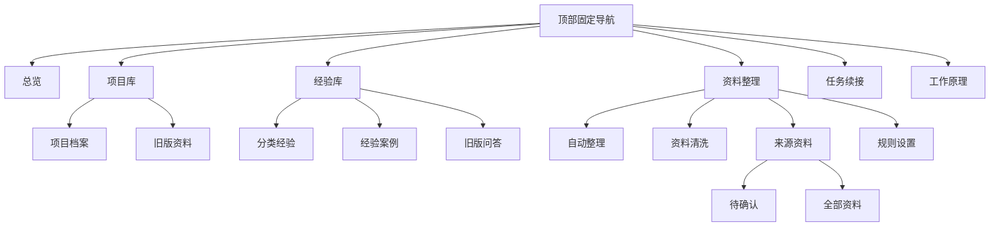
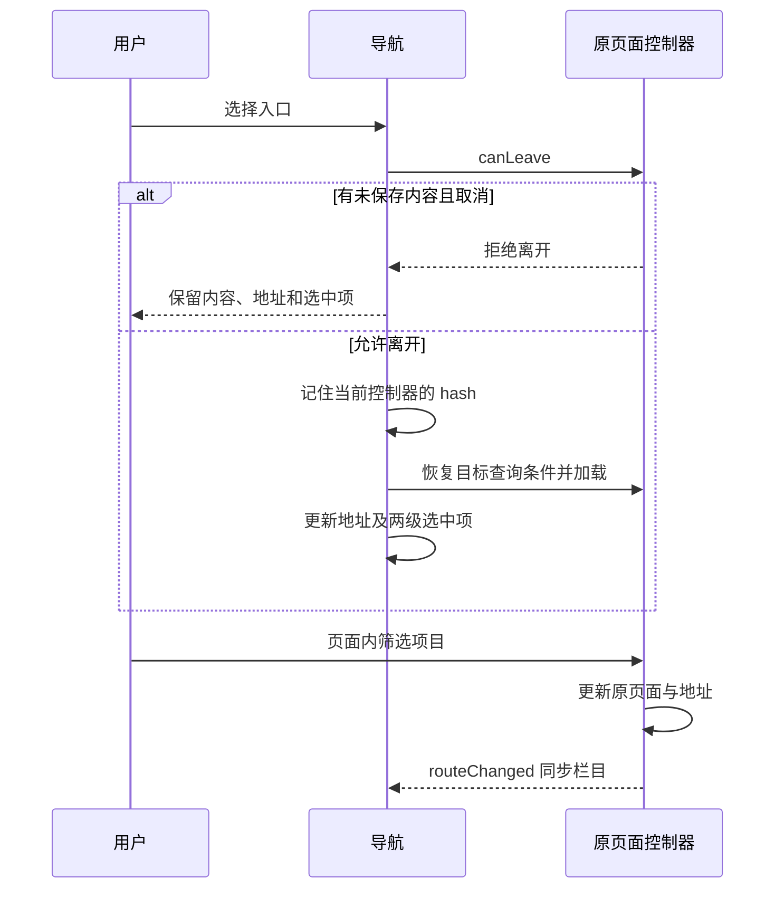

# 已确认的导航与图标

采用用户确认的 Tabler Outline 单线图标、钴蓝品牌标记和雾白石墨配色。只更新真实页面的导航外壳，不发布合成示例工作台。用户随后明确不需要手机端，本次最终验收以电脑端为准。

## 信息架构

项目档案与旧版资料保留原接口及数据；经验分类仍保留前端、后端、测试、数据库等原目录。规则设置继续复用现有提取编辑器和清洗、项目归属规则链接，不统一或改写三套规则的保存语义。带具体项目的旧 library 链接归入项目库；全部资料/全局资料归入资料整理；unassigned 保留旧版项目审阅页。

## 交互与视觉

- 桌面顶栏恢复完整 EvolvMem 品牌，34px 钴蓝标记；六个入口连续排列，不再分三块摊开。
- 图标 24×24、1.7px 描边、无双色填充；主导航文字 15px，点击区最小高度 44px。
- 背景 `#f5f6f7`，顶栏 `#fafbfc`，正文 `#252a32`，辅助文字 `#626b78`，品牌 `#4969cf`。
- 主导航和相关二级页签共同固定；动态测量完整高度，正文锚点与固定工具栏避开顶栏。
- 悬停仅使用轻微颜色过渡和图标 1px 位移；遵循系统减少动画设置。
- 切换前先运行原 canLeave；取消离开时不更换选中项。返回一级入口恢复该栏目的最近页面与 URL 查询条件。
- 原 logout 按钮仍由 auth.js 管理，保留 CSRF、失败提示、菜单键盘和 Esc 关闭行为。
- 图标内嵌 SVG，不依赖 CDN、不增加请求或字体下载。未更改服务端读取、数据库和归档任务。

## 导航状态顺序

## 图标来源

Tabler Icons Outline，MIT，固定 commit `ed177a085b652fe04ec4f37ced867c94621e7840`。使用 layout-dashboard、folder、book、list-check、history、sitemap、user-circle、logout。保留原品牌 SVG，仅改变底色。完整许可见 `LICENSES/Tabler-Icons-MIT.txt`，运行文件 refresh.js 同样包含许可。

## 验证边界

通过隔离合成数据库运行真实 HTTP 页面，检查导航命中、旧链接、项目详情和筛选恢复、未保存规则取消离开、键盘和固定高度；禁止该导航测试发送非 GET/HEAD 请求。桌面检查包含 1024、1178、1440、1920 宽度。生产验证另记录文件哈希、服务状态和鉴权响应，不把合成页面视为生产业务数据验收。
