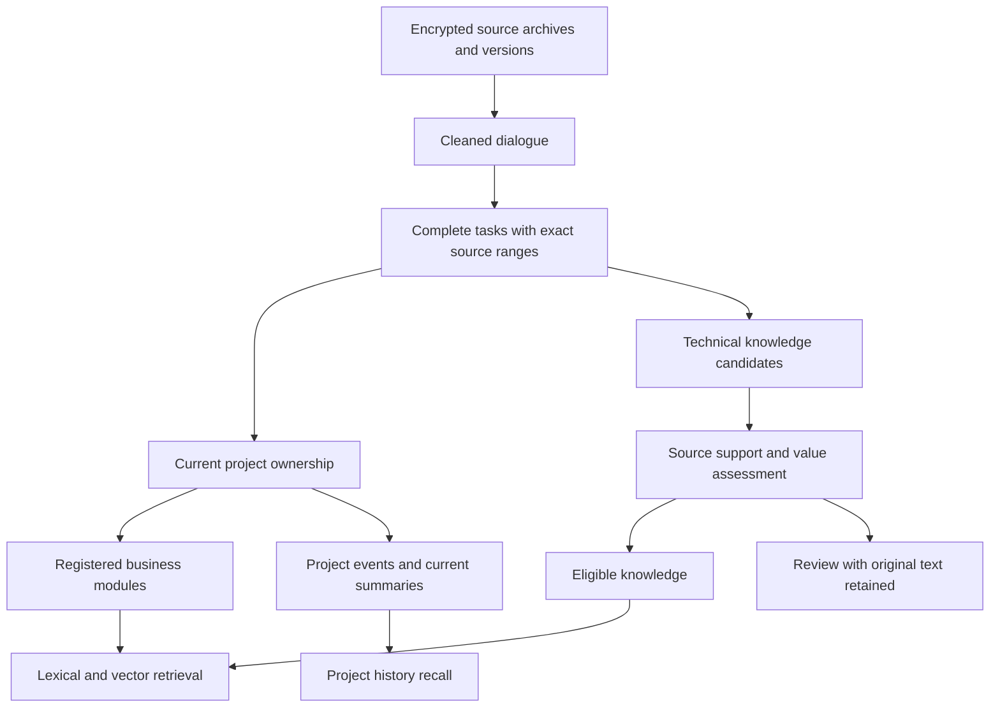

# Source-bound memory governance

This update separates business ownership, technical classification, knowledge
value and observed method verification. It preserves original history and
manual decisions while repairing the primary organization path.

## Data flow

Raw archives, cleaned dialogue, task units, project events, capabilities and
vector indexes are distinct layers. Lossless chunking and compression do not
replace original conversations with summaries. Missing cleaned rows can be
rebuilt only from authenticated available payloads; existing cleaned text and
human cleaning decisions are not overwritten by repair. Large native transcript
recovery streams authenticated chunks through a private disk spool, validates
the complete payload and syntax, and bounds retained text and memory. It never
stores truncated dialogue as a completed repair; temporary plaintext is removed
after normal completion or handled as a private recovery artifact after a crash.

## Ownership and module candidates

The primary organization worker now assigns current units before either
capability extraction or project-history publication. A conversation can
contain several projects; its archive location is not a project decision.
Source revisions and manual decisions are checked before publication, and
unchanged extraction payloads can be reused after an ownership correction.

Current archives carrying a project label are inventoried as well. An explicit,
source-bound governance read grant lets the organization worker inspect their
dialogue without changing the archive label or treating it as confirmed business
ownership. Grants check the current logical head, payload, project declaration
and manual decisions. Historical enrollment uses a reviewed plan; future intake
follows the existing automatic-organization switch and baseline. Authenticated
archives with no business dialogue receive an explicit terminal result instead
of fabricated content or an endless queue entry.

Project ownership uses registered names, aliases, eligible historical lexical
and vector candidates, then current task evidence. Candidate similarity never
establishes ownership by itself. Weak or truncated candidate sets fall back to
the registry, retaining uncertainty rather than selecting the first project.

Saved positive project criteria cannot globally block a different, disjoint
project merely because their result is uncertain. This exception requires a
current direct ownership analysis whose original quotes, task ranges, roles,
source revision and context are revalidated; labels or vector scores cannot
establish disjointness. Overlapping scopes, global or negative criteria, actual
conflicts, human exclusions and prior manual decisions remain protected. Rules
and source evidence are checked again after judgment. Review units retain valid
direct analysis for diagnosis without becoming confirmed project knowledge.

Business modules are registered within a project and remain separate from
technical categories such as frontend, backend and database. Their names,
aliases, status and description use versioned edits. Registered modules are
judged against source quotes and task roles; human assignment or withdrawal
is protected. Empty module registries remain explicit, and model suggestions
are not automatically activated. The project page manages modules, while
knowledge details show the current source and module bindings.

## Value, sources and recall

Knowledge candidates carry kind, trigger, conditions, concrete steps, result,
exact evidence quotes and a value reason. Value checks distinguish useful
reference from reusable procedure, weak review material and noise. Faithful
paraphrases require an independent support review bound to source and candidate
hashes. The support review includes the title as well as the body and structured
claims. Older review receipts cannot bypass a new assessment policy. Assistant
progress claims cannot certify a method as successful.

Equal knowledge can retain several sources. Recall requires current source
eligibility and accepted value evidence from the same source. One source's
assessment cannot authorize another source's project or module. Historical
unassessed active knowledge is labeled as such; adding a weak new source does
not erase an independently valid original source or promote the weak source.
During legacy assessment, any independent unassessed original retained for
compatibility is frozen by origin and content identity. New sources cannot
inherit this exception, and changed original content invalidates it.

The library separates usable, pending and all records. Technical category
confirmation does not bypass source/value checks. Historical records remain
browsable after their current support is withdrawn. Project summaries use
currently supported events, with withdrawn events retained in history.

`capability_search` accepts optional `project` and `module_id` filters, while
the default search permits cross-project reuse. Capability IDs use their own
namespace, separate from Context item IDs and outcome feedback targets.
Lexical backfill is bounded and deterministic when early candidates fail
current-source filters. Vectors use the existing embedding model and a
proof manifest; bounded background reconciliation resumes missing or stale
entries without declaring a partial rebuild complete.

## Historical repair and deployment

Read-only plans inventory logical current sources instead of replaying every
transport snapshot. Separate repairs cover typed ownership, legacy source
bindings, missing cleaned bodies and current task retries. Plans are hashed
and verify source, rule, registry, unit and manual-state preconditions before
each bounded write. Unstarted unchanged queue changes can be rolled back;
processed results and subsequent human edits are retained.

Existing knowledge is assessed in place using its original ID, title and body.
Plans distinguish exact task-unit originals, directly supported archive dialogue,
explicit manual knowledge originals and generated summaries. A generated Context
summary is not treated as original dialogue. Each source receives its own bounded,
leased assessment with source and policy checks before and after model calls.
Missing proof remains reviewable; a new re-extracted record does not count as
an assessment of an older record. These operations neither delete old knowledge
nor infer successful method verification from model output.

Malformed model responses and nonliteral evidence quotes permit one corrective
attempt against the same frozen source. If that attempt also fails validation,
the source becomes a technical review item, with its original retained and a
safe reason code. The invalid response cannot create accepted knowledge or
withdraw independently valid module bindings. Transport failures, changed
sources and expired write leases are handled as operational failures, not as
negative judgments about knowledge value. Technical review and actual lack of
useful evidence are distinct outcomes.

Run repair on a writable backup first. Back up the live database, authenticated
archives, configuration and keys privately before production changes. Source
deployment must preserve unrelated local changes and reject drift from the
reviewed baseline. Runtime counts, unresolved records and deployment status
belong in a private operational receipt, not in public source fixtures.

Verification includes source changes, manual protection, multi-source value
intersection, separate identifier namespaces, rollback/idempotence, bounded
vector recovery, authenticated HTTP write checks and desktop browser flows.
Synthetic configured-provider acceptance checks that concrete unverified
procedures remain unverified and unsupported completion claims are not
published as verified cases. These checks do not certify production migration
completion or the truth of historical method outcomes.
