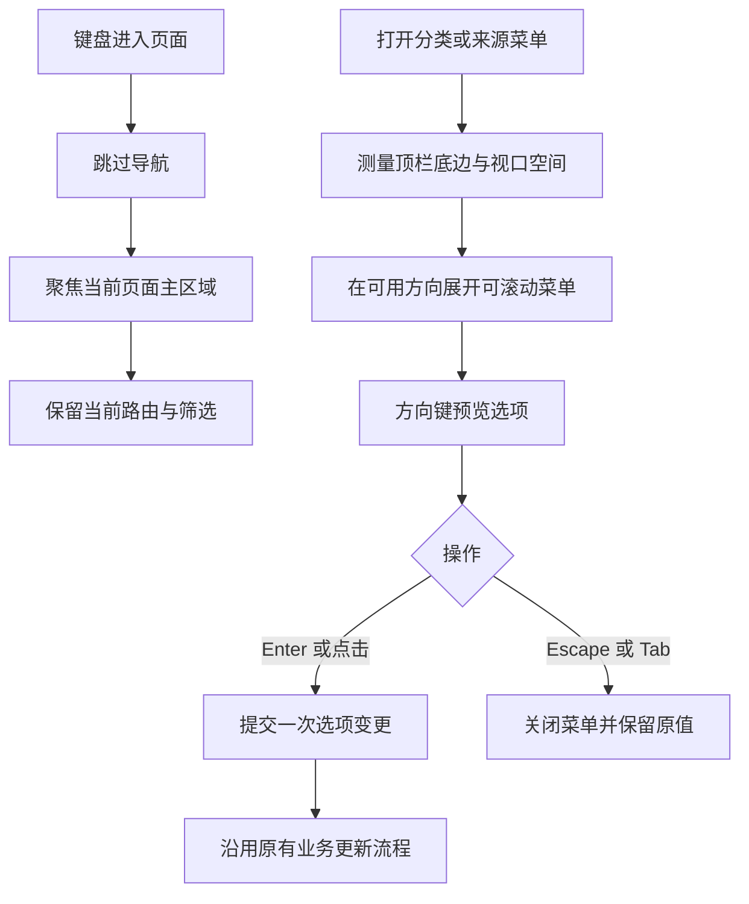

# EvolvMem 导航与下拉交互

保留 A 版深色固定顶部、分组两行、24px 导航图标与浅色全宽工作区。本次只补充交互细节，不调整项目、经验分类或后台读取规则。

- “跳过导航”不修改 hash，避免误触发路由或丢失筛选状态。
- 小屏横滑导航给完整焦点环留出边距，保持文字及图标尺寸。
- 内容区使用实色焦点环；账号和退出按钮使用 44px 点击区域。
- 菜单位置避开固定顶栏并限定在视口内，长选项通过原有换行和滚动完整阅读。
- 活动选项的 ARIA 状态随键盘预览更新；实际业务值只在确认时改变。Tab 保留现有取消行为。
- 动效继续遵守用户的减少动效偏好，不新增字体或动画依赖。

ARIA 预览状态参照 [W3C select-only combobox 示例](https://www.w3.org/WAI/ARIA/apg/patterns/combobox/examples/combobox-select-only/)。本次并非全站无障碍认证，也未覆盖所有读屏器组合。
