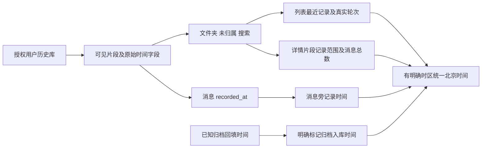

# 历史会话的记录时间与来源

## 范围与原因

历史页的时间并非全部缺失。搜索结果原来没有接上已有的 observed_first_at、observed_last_at、turn_count 和 message_count，前端又把搜索结果写成 0 轮。读取原文时仅保留“角色：内容”，丢弃了消息的 recorded_at，模板也没有时间区域。

本次补齐历史会话列表、片段详情和每条消息的记录时间。结构化经验库是另一模块，不把它的创建或更新时间混入本页。数据库已有值保持原样；不触发 AI、历史重提炼、业务归属迁移或原始归档重写。

## 工作流程与数据边界

- `WorkspaceHistoryReader.hybrid_search` 从已获授权的可见片段补首末时间、轮次、消息数及 time_basis；既有范围过滤和软删边界继续生效。
- `block_turn_page` 保留逐消息 recorded_at，并返回时间来源。现有不带 grouping 的轮次读取也收到来源标记。
- 前端保留片段时间及与正文逐项对应的消息时间，拒绝过期身份/知识库响应。不同会话的消息时间不能串用。缺少轮次时显示“轮次未记录”，真实 0 保留 0。
- 中性 `recorded` 表示现存记录时间，不把最后记录称为会话结束，也不把它等同于最后入库时间。明确时区按 Asia/Shanghai 显示；来源无时区的值保留原文并说明时区未注明。日期只有日精度时不补造午夜或秒数。空或无效值显示“时间未知”。

## 已知归档回填时间

当前 DSH live_session 路径在解析对话时丢失原事件时间，live sync 使用 archive_created_at 回填片段和消息时间。这些现存值标为 `archive_fallback`，页面明确显示“入库时间”和“原对话时间未保留”。不将当前归档时间叫作会话首次入库时间，也不声称恢复了原始消息时间。该路径的完整无时区秒级字符串由既有归档 writer 明确按 UTC 生成，响应可补上 +00:00 以正确换算；日期、无效值和其他来源不强加 UTC，数据库不改写。

其他记录仍用中性的记录时间标签。若未来修复 DSH 原生时间采集，应独立维护来源标记和修复证据，不让这一展示规则替代源数据修复。

## 验证

PG 集成覆盖搜索真实轮次和片段时间、消息来源、归档 UTC 规范化、原值保留、日期精度与未授权/软删过滤。前端覆盖文件夹、未归属和搜索的映射、UTC/偏移量/无时区/空/无效值、逐消息部分缺失、HTML 转义及过期响应。独立 HTTP 浏览器验证桌面与手机布局，继续运行滚动和目录搜索回归。新时间脚本列入 wheel 资产断言。

主界面职责说明同步更新，既有 SSO 定期核对、阅读位置保护和归档目录索引保持各自职责。旧 v1 product_modules 验收的 9/6 导航断言仍是既有失败，不能将其说成已通过。
