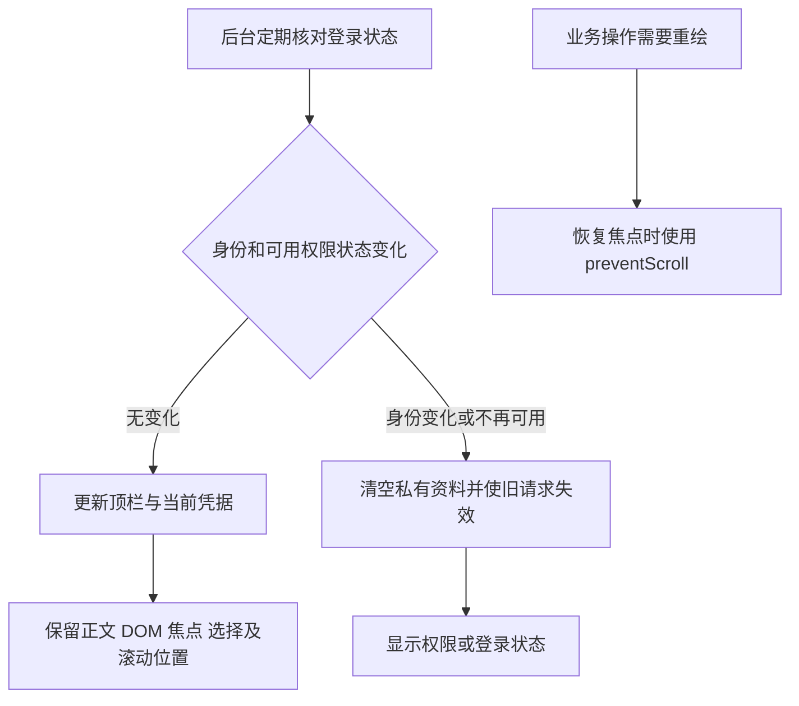

# 后台登录核对保留阅读位置

## 问题与证据

用户反馈历史长页手动滚到顶部后，过一会自动跳到底部。代码每 5 秒核对登录状态，不论身份和权限是否变化都调用 renderAll，替换整块正文 DOM；重绘后还用默认 focus() 恢复焦点。

在独立长会话 HTTP fixture 中明确复现：稳定状态轮询将左侧列表 scrollTop 从 600 重置为 0；用户保留搜索框焦点并向下阅读时，手动重绘将 window.scrollY 从 6000 拉回 0。相同 Chromium 中“顶部直接跳到底部”暂未稳定复现，不能将该方向的跳动描述为已复现。修复针对已经确认的定期 DOM 替换和焦点抢滚动机制。

## 行为与职责

登录核对仍每 5 秒执行；401、403、503、身份切换、内部账号待分配/停用等原有清空边界保留。稳定 ready 状态只同步顶栏、姓名和 CSRF，不替换正在阅读的正文。必要重绘时使用 focus({preventScroll:true}) 保留当前视口，不添加自动滚到底部逻辑，不关闭权限复核。

主界面“登录与知识库访问”的说明同步维护。后台目录索引、历史业务归属、上传和 MCP 服务保持现有流程。

## 验证

- SSO 单元回归：稳定身份不重绘且凭据及时更新；身份/权限变更仍立即隐藏私有内容。
- 浏览器回归 history_scroll_stability.e2e.cjs：真实正文点击及滚动、跨轮询列表位置、必要重绘的焦点恢复、权限撤销。旧 bundle 的失败与候选版通过分开保留。
- 相关前端、SSO/HTTP/PG、打包导出测试继续运行。旧版 product_modules.e2e.cjs 仍存在导航项实际 9、预期 6 的既有失败，单独记录，不伪称通过。
