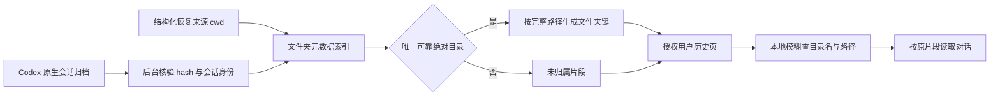

# 历史页按实际工作文件夹浏览

## 用户规则与数据边界

历史页统一按 Codex 会话记录中的实际工作文件夹显示。名称取真实末级目录，完整路径用于区分同名目录和模糊查找。路径大小写按客户端规则比较：Windows 不区分大小写，POSIX 区分。真实存在的 `new-chat` 文件夹仍显示原名；没有目录、身份不符或工作目录冲突的片段进入“未归属片段”，不根据正文、项目别名或默认 `codex` 标签猜测。

其他客户端已经有结构化恢复来源 cwd 的片段也按真实文件夹展示；无可靠目录的保留在未归属。归组使用完整路径，不实时扫描客户端磁盘，也不代表 Codex 侧栏的友好项目名。原始归档、业务项目关联、人工归属及任务续接保持原值。旧回收站仍生效，不因换分组而重新显示被隐藏的历史。

## 架构与流程

`workspace_index.py` 在 HTTP 请求之外生成投影，只向 `em_history.candidate_meta` 的 `workspace_projection:v1:` 命名空间写目录元数据。每个片段的 JSON 与简单文件夹键在同一事务更新。指纹包含片段版本、源档案、物理文件版本和解析器版本；不变片段直接复用，临时取证失败按间隔重试。新片段版本与索引不一致时暂列未归属，后台更新后重新归组。

Codex 仅读取原生 `session_meta`、`turn_context` 中的 cwd，并核对原生 ID、封套 session_id/source.session_id 及设备身份。旧迁移没有原生 ID 的片段保留该证据限制，不伪造 ID。来源由片段的 source_archive_ids 与 sources.block_id 精确关联；增量归档可能只在早期段含 cwd，须综合全部相关段。冲突不强行挑一个目录。非 Codex 不从普通正文中识别路径。

旧加密档案按 storage 的 manifest/content hash 和长度验证，保留不可变 payload_sha256 的证据版本语义。大归档复用逐块认证和流式 JSON 组件，明文仅在私有临时目录内使用并清理；页面请求不解密原归档。索引更新不调用 AI，不触发经验提炼。

`WorkspaceHistoryReader` 仅供 `grouping=workspace` 的目录视图使用，复用用户库 ACL。目录列表和未归属没有旧 200 条预截断。正文搜索的目录/未归属范围在排序和 LIMIT 前过滤。目录软删使用 `kind=workspace`，与旧项目软删分开；正文、轮次、附件和搜索遵守隐藏状态。同名目录在回收站也显示完整路径，恢复只作用于所选目录。

## 运维

先备份当前命名空间，再运行 `python -m evolvmem.history_pg.workspace_index --owner <configured-owner> --apply`；不加 `--apply` 只核查。按既有历史库配置和服务数据目录运行，不输出凭据、正文或原始归档。已有索引异常需要完整重核时使用 `--force`。

本次为当前用户安装每 60 秒触发的独立 systemd 元数据索引任务。单次任务不重叠，正常轮次只处理变化片段。上传归档进入历史浏览表后，下一轮索引补上目录；上传/历史同步尚未完成时不能声称已出现在目录。新增其他用户的索引任务须显式使用其已配置 owner，不借当前用户库代替。Web 使用新的只读投影；MCP 的业务绑定与现有运行目录不改动。

## 验证与发布

- PG 隔离集成覆盖路径规范、同名目录、未知与冲突、索引过期、原项目不被改写、软删/恢复、搜索范围在 LIMIT 前过滤、原文访问及授权。
- 索引测试覆盖原生身份、封套身份、正文伪路径、hash 错误、压缩后证据版本、私有临时目录和大档案流式分支。
- Node 与独立 HTTP 浏览器覆盖目录模糊搜索、键盘/输入法、完整路径、未归属关键词、慢响应、切库和手机布局；此合成验收不冒充真实用户登录后的点击验收。
- 保留主界面模块职责/流程说明，同步源码、测试和本文后提交现有集成分支。发布不可变 Web bundle，保留 SSO 与权限配置，不切换 MCP。

旧 `product_modules.e2e.cjs` 仍以 v1 的 6 个导航项断言为准，而当前 v1 实际为 9 项。该既存失败需单独维护，不作为本次 v2 目录功能已通过的证据。
