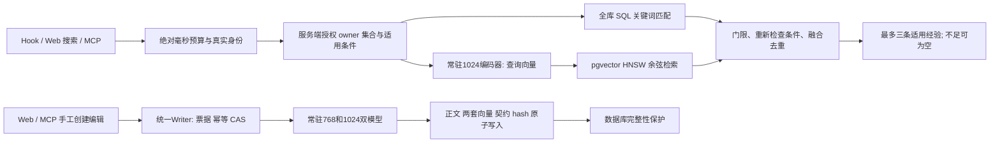

# 经验混合检索与向量闭环

## 已确认范围与实现顺序

2026-11-17 用户授权：Hook 的剩余约 2 秒预算必须真正受保护；1024 维常驻模型，PostgreSQL 完整授权集合的 SQL 关键词和 pgvector HNSW 余弦双路召回；相似度下限与适用范围过滤；补齐两条手工经验的空向量，并覆盖 Web v2 和 MCP 的手工创建、编辑。

1. 保留现有 768 维 admission/dedupe 空间；新增独立 1024 维检索投影，记录模型契约、正文 SHA256、投影更新时间。旧向量不补零、不混用。
2. 独立 loopback 常驻服务启动时校验模型 SHA、维度与 pooling，预热后就绪。请求不加载模型；忙和超时明确失败，后台恢复。
3. SQL 两路先执行 owner/status/有效期/project/constraints 过滤。关键词在全量授权库匹配，向量走 HNSW `<=>`，原始余弦下限 0.72 后再融合排序，不为达到三条补弱结果。
4. Web 非空搜索、MCP recall 和手工搜索共用检索核心；Web 无查询仍按原有列表浏览。Hook 通过当前查询直接召回，变化游标不能代替当前查询。
5. Writer 先验证授权、票据、幂等和 CAS，再调用共同编码器；正文与 768/1024 投影同一事务提交。失败返回 503；编辑保留旧正文与旧向量。成功重放不重复编码；删除与退役不依赖编码器。
6. 备份生产经验库与运行配置。逐条带正文 revision/hash 补算投影，保留正文、来源、状态与修订时间；全量核查后在短暂写锁内启用数据库完整性保护。

## 模块职责和数据流

768 模型为 bge-base-zh-v1.5 f16，SHA256 `cbb58f04476cc2e6adf33170f667def5d0e15468ca96f3821b0fee1a454f6c0c`。
1024 模型为 CompendiumLabs/bge-large-zh-v1.5-gguf Q8_0，固定 revision `c8efef27bde5b935ea27500a9b0f1d6a70a2800c`，文件 SHA256 `fa3e2d5215eaf6652c39bb2ff3e0790a12c81d6a7eaf648c79e71c3dc68cd88f`。模型文件不进入源码仓库。
模型空间、prefix、pooling、截词规则和格式组成契约；SQL 不使用旧契约或正文 hash 过期的投影。查询输入最多 128 token，文档最多 512 token；只截输入，不截向量。

## 运行与回滚

服务配置通过 `EVOLVMEM_EXPERIENCE_EMBEDDING_CONFIG` 传入，默认 loopback `127.0.0.1:9380`，不得公开外网模型端口。先启动预热服务，再切换 Web/MCP/流水线运行包。保留 SSO、访问授权和自动处理暂停状态。

`python -m evolvmem.experience_v2.projection_maintenance` 默认只读；备份后加 `--apply` 才逐条修复。最终完整性策略由维护者锁表核查后启用，迁移本身不启用。退回旧 Writer 前必须先停用策略；保留新增列、已补向量、备份和新写入，不恢复过期控制面权限。

## 验证记录

- 隔离 PostgreSQL 55434 最终回归 225 passed / 1 optional real-model test skipped，包含分页修复与实际 HTTP MCP 创建/编辑/重放/冲突/编码故障原子性联合测试。真实双 GGUF 另行 34 项通过。
- Node 前端/SSO/历史 37 项通过；真实 Chrome 的语义结果、查询竞争、登录态、1440/390 页面通过。
- Windows PowerShell 5.1：挂起 1894ms、slow-drip 1873ms、临界预算 1886ms；这些是隔离故障 fixture。实装 Hook 最小更新，保留其与源码不同的历史逻辑。
- 生产补算 362 条 active 经验后：legacy_missing=0、retrieval_missing=0、invalid=0。补算前为两条手工经验缺 768 向量、362 条均无新增 1024 投影。
- 生产备份恢复到隔离 55434，按相同 UTC 序列化比较全部 746 条 notes 的正文与非向量元数据，摘要完全一致；原修订、时间、来源和状态未改变。
- 常驻生产服务启动校验就绪，20 次实际 loopback 查询 P50=69.09ms、P95=95.14ms。无关的帝企鹅孵化问题返回 0 条，未凑三条。
- Web 分页由完整 filtered SQL 匹配集合稳定排序，350/370 条同分与混合命中分页无重复遗漏。HNSW 先行，Hook 过滤后短取可在同一 deadline 内精确 SQL 补查，诊断注明 fallback。
- 指定旧 product_modules.e2e 在隔离 /v1 仍因导航 actual9/expected6 的旧断言失败；未修改产品迁就此断言。独立工作原理页面图文截图、390/1440 无溢出与无 pageerror 通过。

已完成 Web/MCP/流水线/回填运行包切换；常驻编码服务就绪，Web/MCP/编码服务均 active，central_sso=true。完整性强制策略已在最终锁表核查后启用：362 active、768 缺失0、1024缺失0、契约/正文hash异常0。

Windows 实际 MCP 改写问题请求 334ms、关键词与向量同命中1条、cosine=0.728489；无关问题162ms、0条。已安装 Hook 完整 prompt-submit 实测1404ms、目标经验进入上下文。该实测还发现 OS 环境变量缺失会导致旧平台识别失效，现改用真实 OSVersion.Platform；最终实装 SHA256 `eb472a77108473686325d7370664970b152532bbd7afcb1fc3f41a01a3e96779`。平台修正后 PS5.1 故障 fixture 再测挂起1863ms、slow-drip1853ms、临界1857ms，全部通过。

生产 EXPLAIN ANALYZE 确认 idx_experience_notes_retrieval_hnsw 被使用，临时规划设置已恢复。Hook 仅传已知项目；constraints 必须由调用者提供已观察到的事实，不臆测目标环境，返回条件仍须核对。

私有备份/回执保存在服务器 `evolvmem-governance-backups/20261117-hybrid-retrieval/`，本地验收回执在工作区 artifacts/hybrid-recall-20261117；均不进入公开源码。仅在 55434 构造测试数据；55432 的写操作仅为已授权迁移、真实经验投影修复及完整性策略。
