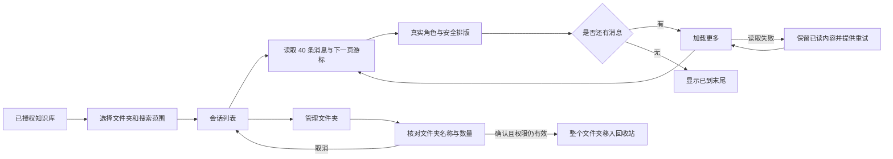

# 历史会话阅读与文件夹管理

## 本次行为

1. 气泡按消息真实 role 区分用户、助手和其他角色，兼容旧演示数据，连续同角色不会交替上色。
2. 正文保留段落、换行、标题和代码块。已知 skill、external_codex 等注入与文件清单默认折叠，展开可查看原文。HTML 一律转义；实体清理只用于展示，不改归档。
3. 桌面左右等高，列表和消息分别滚动，阅读头部保持可见；重新渲染保留滚动位置与注入块展开状态。小屏上下排列。
4. 每页 40 条，后端提供 has_more 与 next_offset；显示已加载数量，支持加载更多、失败重试和末尾提示。网络故障及 HTTP 200/pg_connected=false 降级均保留已有内容、游标和重试入口。
5. 整个文件夹的回收操作放在列表管理区；弹窗列明文件夹名称和会话片段数，确认前不发送写请求。提交时重新核对当前库、用户会话、目标和权限，防止重复提交。
6. 桌面导航可换行，登录区按钮高度统一。阅读页紧凑标题与默认折叠说明释放首屏空间。
7. 搜索保留文件夹选择，默认搜索当前文件夹，可明确切为全部文件夹。过期搜索结果不能覆盖后续选择。
8. 筛选按钮、输入、范围选择和弹出层清空按钮统一高度；未归属计数使用接口 unassigned_count。
9. 捕获状态操作按内容宽度排列。来源抽屉改为紧凑信息弹窗，只展示真实文件夹、路径、记录指针、起止时间和时间依据。
10. 检索评分拆解、设备切换与跨端捕获尚未接通，本次不生成假数据或宣称已接通。

## 数据与交互流程

前端 history-content.js 负责安全展示；api-adapter.js 负责消息分页、搜索范围和过期请求隔离；app-shell.js 维护阅读状态与确认交互。history_pg/candidate_reader.py 通过多读一条判断有无下一页。无数据库结构、原文数据或后台采集任务变更。工作原理同时更新 principles.js 与 v2/js/live-views.js。

## 验证范围

- Node 回归覆盖真实角色、安全折叠、分页/重试/降级、搜索范围及竞态、文件夹确认与防重提交。
- 隔离 HTTP 浏览器验收覆盖 116 条消息、1280/1440/1024/390 宽度、双栏滚动、筛选控件、来源弹窗、捕获按钮和总览流程；数据为合成资料。
- 现有文件夹选择、北京时间、SSO 轮询、权限撤销回归继续验证。
- 后端分页、历史接口及 wheel 静态资源打包测试使用隔离数据环境。
- 旧 product_modules.e2e.cjs 使用历史版 DOM，当前默认 v2 页面不提供其 #history-list .history-entry 入口；单独记录该兼容性限制，不把其失败算作通过。
- 上线核验运行包校验和、Web 健康和匿名 SSO 门禁；不执行生产删除，也不把隔离浏览器测试当作用户本人登录验收。

### 2026-11-18 发布前结果

- Node：64 项通过；后端与 wheel 打包：12 项通过。
- 新版阅读器浏览器检查：23 项通过，JavaScript 错误 0，生产写操作 0。1280×800 时阅读区顶部约 216px，两栏高度均约 568px；筛选控件均 42px。
- 原有文件夹选择、阅读位置与 SSO 轮询、时间显示三套浏览器回归通过。
- 旧 product_modules.e2e.cjs 在修改前基线 0af52c5a 与本次候选均因旧选择器超时，尚未迁移；新版总览流程图在专项浏览器检查中另行验证并检查截图。
- 两轮独立代码审查发现并修正了失败续载后的会话切换，以及 HTTP 200 数据库降级两种边界情况；最终无剩余阻断问题。
