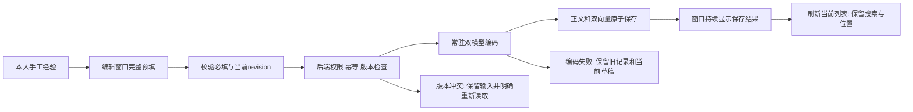

# Web 手工经验编辑入口补齐

## 问题与范围

用户在混合检索交付后追问 Web 和后端是否都补齐。复核发现：76995cd 的 Web v2 已有搜索和新增，后端 /experiences/write 已支持 update 并原子计算两套向量，但页面没有编辑入口。此前将“后端编辑链路已完成”概括成“Web 编辑已完成”不准确。本次补齐实际操作入口和明确反馈，继续保留现有用户、权限、登录、搜索及列表位置。

## 页面和写入流程

1. 自己的生效手工经验显示编辑按钮；读取现有分类和三段正文，完整预填。其他用户库、非手工和失效记录没有入口。
2. 表单校验真实输入，空字段不再替换成占位经验。幂等键由客户端内部稳定管理；同一次内容重试用同一键，改变内容则换键。
3. 提交时在表单内持续显示进度、禁重复提交；请求包含 id 和当前 expected_revision。
4. 后端先验证身份和写权限；update 必须有正整数 expected_revision，拒绝缺失、布尔值、小数或字符串等绕过版本检查的提交。
5. Writer 校验 revision 与幂等，调用常驻编码器；正文、768/1024 向量、契约与 SHA256 一起写入。编码故障保持旧记录。
6. 成功、冲突、编码失败和列表刷新失败分别给出明确反馈。写回执成功后不能因后续刷新失败而误报保存失败。冲突保留输入，由用户明确重新读取，不自动覆盖。
7. 模型临时故障不等于退出登录；同一身份仍有效时保留草稿。真实身份/权限撤销仍清理旧私有数据。

## 验证与发布

隔离真实 Web HTTP + PostgreSQL 55434 + warm loopback 编码服务的测试，启用向量完整性策略，验证成功、重放、版本冲突、CSRF、他人写入和编码故障；不在生产 55432 构造测试记录。最终后端相关回归 **228 passed / 1 optional real-model test skipped**，其中包括真实浏览器点击编辑 → 实际 Web HTTP → PostgreSQL 55434 → 常驻 fake 编码服务的联合验收；读回 revision=2、768/1024 维及正文 hash 一致。该测试没有拦截业务 API 或直接替浏览器调用写接口。

前端 Editor、SSO、混搜、历史等 **49 项 Node 测试通过**。实际 Chromium 端到端覆盖 11 次合成 POST，验证冲突、编码失败、写回执丢失、关闭/重连/重开不重复创建，以及写入成功后读失败仅重新刷新。独立 Chrome 审查复验所有已发现 P2 修复，未发现未解决 P1/P2。1440/390 截图核对无横向溢出和 pageerror。

指定旧 product_modules.e2e 再次在 /v1 的导航断言失败（actual9 / expected6），仍按已知旧脚本问题记录；独立工作原理页面 1440/390 检查通过。未将旧脚本失败说成全仓通过。

上线只更新包含页面与其后端 API 的 Web 运行包；MCP、编码器和流水线代码没有相关变更，无需重启这些服务。发布时校验清单、SSO 状态和生效经验向量完整性，记录到私有备份目录 `evolvmem-governance-backups/20261118-web-manual-editor/`。

本次不更改模型契约、向量字段、已有经验正文、AI 自动处理开关或 SSO 应用选择。前后端必须作为同一运行包发布；回滚保留已成功保存的新数据。
