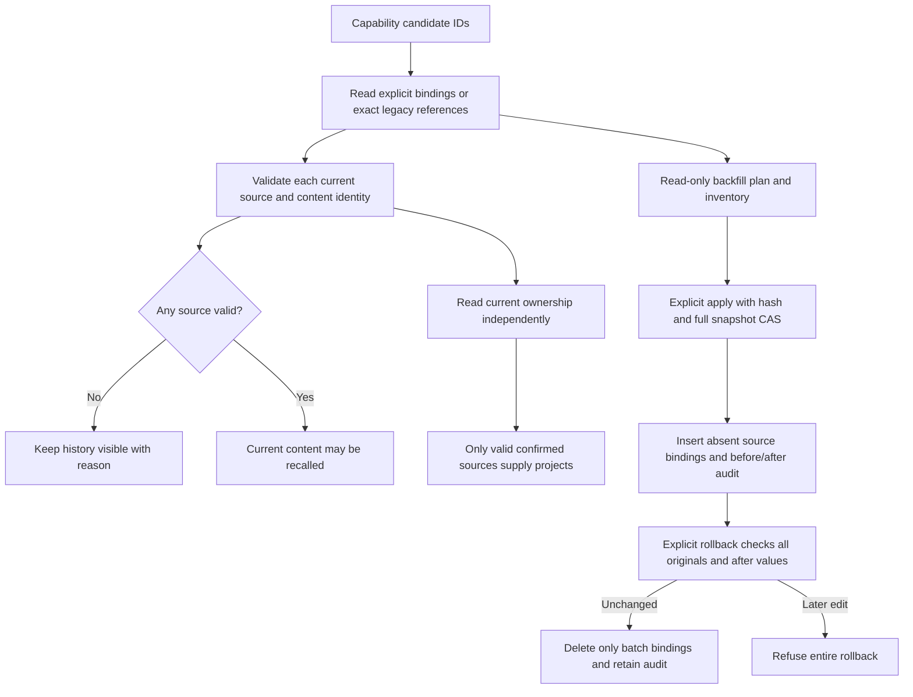

# Capability provenance and historical backfill

Capability content validity is separate from project ownership and experience success. `capability_provenance.annotate(context_store, ids=None)` returns a dictionary keyed by capability memory ID, with `eligible`, `content_valid`, `ownership_confirmed`, `source_projects`, `legacy_fallback` and per-source `valid`/`reason` diagnostics. `eligible_memory_ids(context_store, ids=None)` returns the eligible ID set. These are capability IDs, never Context IDs. `ReadStore(conn)` is a SELECT-only adapter for offline audits and does not initialize any schema.

Call the API once for a page or candidate batch. Do not filter historical management listings away: an invalid or unanchored source remains reviewable with its original memory, and the annotation explains why default current recall cannot use it. No provenance function changes status, text, project, counters, archives or resolutions. `eligible` means current knowledge content, not a verified successful method. Experience verification still belongs to its dedicated evidence service.

The store instance can reuse archive visibility IDs and computed source revision hashes while `(connection identity, PRAGMA data_version, connection.total_changes)` stays unchanged. Other-connection commits and this connection's writes invalidate the cache. It retains no prose, clears above 4,096 revision keys, and is never shared across an open transaction: SQLite's change counter does not rewind on rollback. Unit digest and ownership are still read for each request. A `ProvenanceRead` object itself is a single-request view and must not be reused after a mutation. Persisted source annotations include `source_id` so an assessment gate can require value evidence and current content support from the **same** source.

## Source rules

- A unit must have exactly one matching `(task_id, digest)`, a task whose **status** is not `superseded`, no replacement pointer, and disposition `keep` or `history_only`. `decision=review` means ownership is unresolved and does not alone invalidate content; disposition `review` or `set_aside` withdraws it.
- The claim's source revision must match the task and a fresh recomputation from original source metadata, cleaned body, cleaning revision and conversation membership. An archive must be available and pass the existing current-version/system-source visibility oracle. Missing readable cleaned bodies are `source_body_unverifiable`; the read gate does not decrypt raw archives to hide this uncertainty. Source item revisions match the existing knowledge editor's revision algorithm.
- The unit digest is recomputed from the current source key, exact unit text and original range using the existing `unit_digest` contract. Bound unit revision may advance after a manual ownership edit when this content identity is unchanged. The annotation then sets `ownership_updated`; it uses current unit ownership. A revision rollback, digest mismatch, changed range, superseded task or changed underlying source cannot pass.
- Unit projects come only from current `auto`/`manual` assignment, must all be active canonical registry keys and must agree with scope. Global content stays global. Unconfirmed or invalid sources contribute no project labels. Stored capability `source_project`, stored binding `projects`, and self-reported `evidence_status` do not override current authority.
- A Context source must be active, not superseded, within its validity window, and allowed by `memory_eligibility`. Bindings use `context_revision(conn, item_id)`, a content-type/layer-hash signature; ownership edits are read separately. Only a current accepted/resolved ownership record matching the item's project supplies a project label.
- Unanchored `manual`/`reference` claims are reviewable, with `unanchored_reference`, but cannot self-certify current recall merely by setting `confirmed`. A caller with an actual Context or unit anchor should write that typed source kind. Ordinary browsing still displays the record.
- Multiple sources are evaluated independently. One valid source retains content; only valid, currently confirmed sources contribute `source_projects`. One withdrawn source cannot remove another independent source's support or contaminate its projects.

## Legacy compatibility and migration

When an object has no explicit source bindings, the reader temporarily resolves exact `knowledge_restructure_map` capability mappings and the old source-ref format `source_key#digest@start-end`. It checks both digest and range, never text similarity. It accepts one unique current unit; multiple current matches are ambiguous. A ref matching only superseded tasks is `historical_unit_only`, including when an old unit had manual ownership. That history is preserved, never silently inherited. Other valid mapped sources may still support the same object.

`python -m evolvmem.capability_provenance_repair` prepares an inventory and insertion-only plan. It works before `capability_sources` exists. Apply requires the additive schema to have been initialized separately in the explicitly selected database; prepare never calls `ContextStore` or `CapabilityStore` initialization.

```bash
python -m evolvmem.capability_provenance_repair \
  --database /absolute/path/rehearsal.db --output /absolute/path/provenance-plan.json

python -m evolvmem.capability_provenance_repair \
  --database /absolute/path/rehearsal.db --apply-plan /absolute/path/provenance-plan.json

python -m evolvmem.capability_provenance_repair \
  --database /absolute/path/rehearsal.db --rollback-plan /absolute/path/provenance-plan.json
```

Default preparation opens an existing SQLite file using `mode=ro`, `query_only=ON` and a read transaction. Output files must not already exist. Only explicit `--apply-plan` or `--rollback-plan` opens `mode=rw`. A missing file is not created. Plan hashes cover all changes, source metadata, full inventory and registry versions. Plans have no raw unit text, memory layers or cleaned archive bodies; hashes are computed locally and the plan retains metadata only. Keep the metadata plan local.

Apply revalidates the complete deterministic plan under `BEGIN IMMEDIATE`. Any source, mapping, registry or original memory/version drift aborts the entire transaction. It inserts only absent bindings, preserves every preexisting binding and never updates capability content, status or the legacy first-project field. `capability_provenance_repairs` records the complete plan, absent before rows and exact persisted after rows in the same transaction. SQL failure rolls back rows and audit together. Reapplying the identical applied plan reports `already_applied` with no new rows. This receipt proves a prior apply, not that no one subsequently edited the source.

Rollback checks the saved hash, exact audit, all persisted after rows, source snapshots, memory versions and registry before deleting anything. Only the batch's inserted binding rows are removed; capability objects and historical evidence remain. Any later source, ownership, binding or memory edit refuses the whole rollback. A late SQL failure also restores all deleted bindings. The audit remains with `rolled_back_at`; repeated rollback returns `already_rolled_back`, and apply of that same rolled-back plan is refused. Rehearse again on a fresh disposable copy rather than resurrecting a rolled-back batch. Use a self-contained backup as the recovery boundary.



## Validation

Real SQLite tests cover missing schema, legacy fallback, expired/withdrawn sources, shared content, current unassigned units, multiple projects, current manual ownership changes, real unit digest/range checks, exact archive/conversation/item revision contracts, source/version drift, existing-binding preservation, hash tampering, atomic SQL failure and repeated apply. No test requires an external model, archive decryption, or production writes. Baseline inventory and performance measurements are separate local artifacts; their source/memory denominators must be distinguished.

```bash
/home/jiangli/hermes-memory-plugin/.venv/bin/python -m pytest \
  tests/test_capability_provenance.py tests/test_capability_provenance_repair.py \
  tests/test_capability_sources.py tests/test_capability_store.py -q
```


## Frozen source text proof

Unit validity also proves the stored text against the task's frozen source:
contiguous coordinates must select exactly the unit text; non-contiguous
`source_ranges` must be ordered, non-overlapping, in bounds, share the declared
start/end, and reconstruct the unit exactly with the existing two-newline
separator. A self-consistent unit digest alone cannot prove that the unit is
original source text. Failure reports `unit_source_text_unproven` and keeps the
stored record browsable while excluding it from default recall.

`capability_source_proof.unit_source_proof(store, task_id, digest, messages=None)`
reads bounded SQLite `substr` slices, not a whole task snapshot. It returns the
proven text, ranges, content hash and input hash only after matching. Ownership
revision changes do not change this hash. The caller must separately apply the
live source-version and eligibility gate; frozen-text proof does not verify a
method's outcome.

Roles default to unknown. Optional messages must come from the real structured
source and render to exactly the frozen snapshot before their spans are mapped
to local offsets across all ranges. Neither role-looking text nor narrative
summary labels establish a role. This supports legacy complete tasks whose
units deliberately collect several disjoint original ranges.
