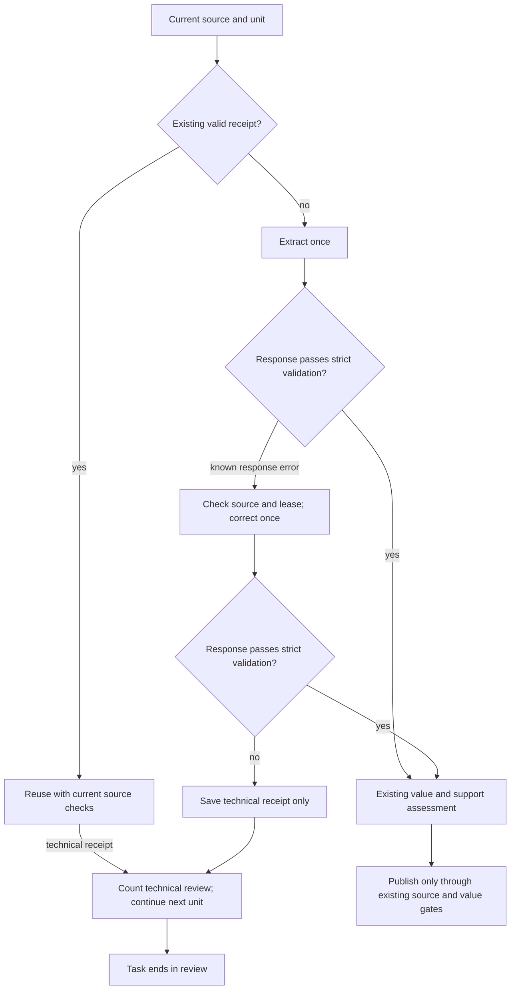

# Primary capability extraction: bounded response correction

Primary and dual organization modes treat a malformed model response as a unit-level technical problem. A bad response must not publish knowledge, remove existing valid knowledge, or repeatedly restart all units in its task.

The extractor may make its original call and one correction call. Only JSON-object decoding and the existing action, memory, keyword, timestamp, structured-value and exact-quote validators qualify. The correction repeats the same original unit and category instructions with fixed error codes and field-type diagnostics. It never repeats rejected model values.

A second invalid response produces a server-created technical receipt, with reason `model_response_invalid`, attempts `2`, two safe error codes and diagnostics. The receipt uses the existing source/revision/unit extraction key and carries no candidate title, body, quote, assessment or binding. Replaying the same input returns that receipt without another model call. A model cannot supply a technical receipt itself.

Source, rule, manual-unit and extraction-lease checks run before and after each attempt, and before receipt storage. A cached technical receipt also checks current source/manual state before its outcome is returned. Source or lease conflicts, provider exceptions and storage failures still abort. A provider exception remains a provider exception even when its message happens to equal a recognized validation code.

Valid `ignore`, unknown-category intake, and valid semantic `supported=false` responses retain their existing behavior and are not corrected. This patch does not alter assessment-policy:v2, support-review acceptance, ownership rules, source proofs, or existing valid extraction keys. It does not add retries to independent support review.

The pipeline returns `technical_review` and content-free `unit_outcomes` alongside its existing result fields. The worker consumes the technical count in both primary and dual modes, records `capability_response_invalid`, and finishes in review. Existing module technical review also remains counted. In dual mode, unfinished or failed legacy extraction takes precedence over a terminal technical-review state. Every later legacy refresh reads exact current-input capability receipts and exact current-registry module receipts without a model call; when legacy extraction finishes, current technical receipts restore the review outcome. Changed original text, rule version, module registry or manual module exclusions cannot borrow an old receipt. The extraction key, module registry filter, contract ordering and validation are shared with their write paths instead of reimplemented. Technical failure creates no capability memory, assessment, intake, category suggestion, source binding or vector entry, and retracts none of the earlier ones. Other units and the independently guarded history/module paths continue.

A technical receipt intentionally remains stable for the same extraction input. A deliberate future recovery process must decide which exact failed receipt to invalidate or supersede; ordinary task retries do not silently spend more calls. Transport failures do not receive technical receipts.

## Validation and deployment boundary

All tests use temporary databases and fake providers. Coverage includes bad-then-valid correction, two bad responses, exact-quote rejection, malformed JSON, invalid dates and field types, forged technical envelopes, continued processing of later units, preserved old knowledge/manual state, same-input replay, concurrent source/manual/lease changes, provider/storage errors and primary/dual task outcomes.

Production tasks 1883 and 1885 only exposed the exception class ValueError. This implementation addresses the demonstrated primary validation mechanism; it does not claim that either historical failure came from a particular field. No production data or model calls are needed to validate this change. The branch is prepared for review and later deployment by the release owner.
