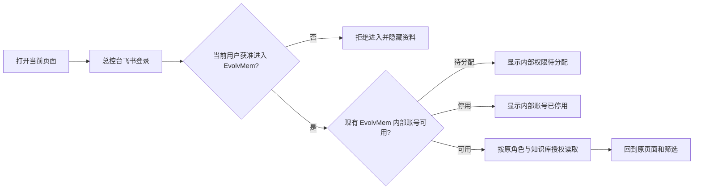
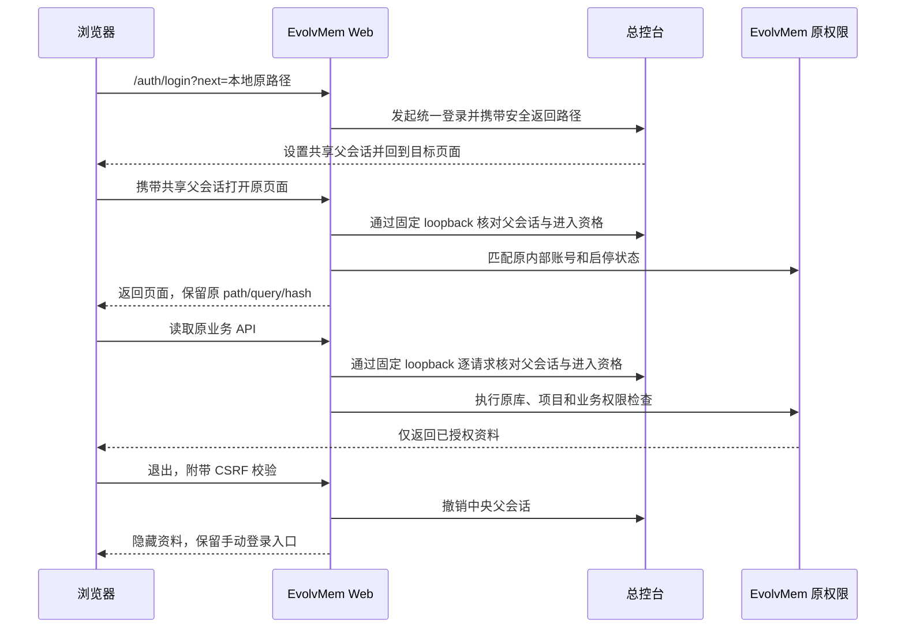

# EvolvMem Web 的总控台登录边界

本次只接入 Web。总控台 SSO 配置默认关闭；未开启时保留原独立飞书登录。本次不改变 MCP 接入、后台整理、AI 开关、记忆归属、内部管理员角色或原知识库授权。

总控台决定能否进入；EvolvMem 继续决定当前用户能看和管理哪些知识库。中央管理员资格不转换为 EvolvMem 管理员。`/auth/ops/status` 的 `can_write` 保留旧版 owner 语义，不用于覆盖 v2 的原账号、库和业务权限。

浏览器先从 `/api/auth/me` 读取 `central_sso: true` 标记，确认启用后才使用总控台状态接口。每 5 秒以及窗口重新获得焦点时核对身份。401、403、503 或身份变化会隐藏业务资料、关闭详情和编辑窗口，并使晚到请求失效；不会通过演示资料绕过授权。

同一用户的筛选与未保存草稿按不透明身份作用域保留；各知识库分别保存浏览状态。重新登录后，只有确认相同身份及该知识库仍可访问、可管理时才恢复相关内容。切换身份和知识库先清空旧业务载荷。浏览器缓存不替代服务端访问检查。

默认 v2 首页“登录与知识库访问”展示相同的三层边界。原理入口继续使用现有页面路由，不改变产品导航与整理流程。

## 验证范围

本次隔离验证通过 89 项 Python 测试（统一准入、原 Web/auth 和公开源码导出）、19 项前端 Node 测试，以及 8 组合成身份浏览器场景。独立复审另外验证了 20 个身份切换微任务顺序和 39 个详情最终应用检查，旧身份的数据不会进入新身份页面。浏览器夹具没有请求生产服务，测试数据不进入真实记忆库。

原 `product_modules.e2e.cjs` 使用旧版页面选择器；未修改基线与本次候选都在相同的首条历史列表选择器处超时。这项旧脚本没有通过，不能据此宣称整套业务验收完成。真实员工的飞书授权点击需以实际浏览器登录结果为准。

## 公开快照分支

此分支是当前已部署 Web 运行基线与总控台 SSO 接入的公开源码快照，采用独立的新 Git 历史。它不表示已合并仓库 main，也不包含私有开发历史、实际运行配置或记忆数据。部署环境仍需单独配置现有账号和授权。
