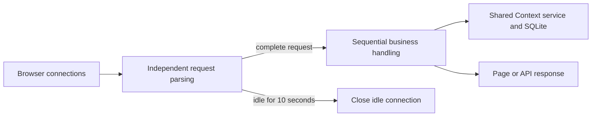
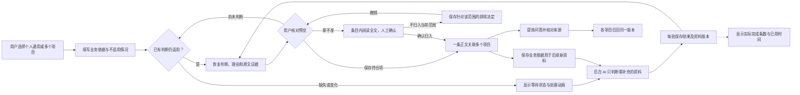
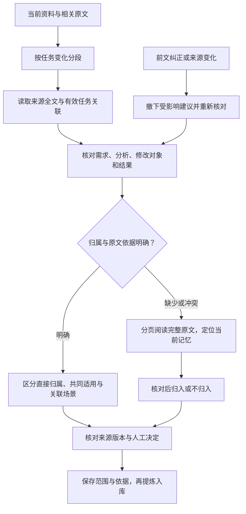
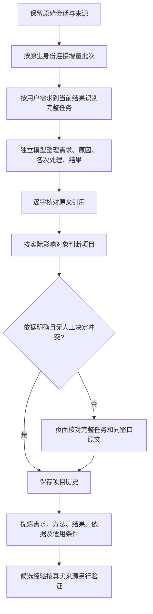

# Context Core 技术参考

安装和入门请先读 [README](../README.md)。本页保留存储、生命周期、续接与参数的详细说明。

Context Core is the canonical EvolvMem store once the run mode leaves `legacy`: every memory is one typed `ContextItem` and SQLite remains the content source of truth. In `compat`/`shadow`/`primary` modes the legacy `memories` table becomes a transactional legacy projection — one outer `BEGIN IMMEDIATE` writes the `ContextItem`, its three layers, the legacy projection row, and their ID mapping — so adapters that have not switched keep reading their old shapes while every canonical write lands in Context Core. Both vector indexes stay derived, independently dirty-able caches updated only after the SQLite commit; the Context Core cache is `context_vectors.usearch`, separate from the legacy `vectors.usearch` throughout the transition.

Context Core's L0/L1/L2 names describe three bounded representations of one `ContextItem`, not the legacy stack's active/history/vector labels: L0 is the compact retrieval representation served by search, L1 is the bounded detailed representation rendered into session-start injection, and L2 retains the complete source/evidence representation, disclosed only by exact context ID. Default FTS/trigram indexes contain only L0 and L1; an explicit vector rebuild uses active, unexpired L0 only.

### Run modes

`context_mode` (persisted in `config.json`, overridable per process via `EVOLVMEM_CONTEXT_MODE`) selects one of four modes; an unknown value fails closed to a diagnostic tool set:

| Mode | Behavior |
|---|---|
| `legacy` | Code default. Context reads are disabled (`context_not_enabled`); all reads/writes use the service-owned legacy backend. |
| `compat` | Persisted only by a successful formal cutover. Context Core is the canonical write store and the legacy projection is kept in sync transactionally; Context reads stay disabled for the process. |
| `shadow` | Codex/Kimi/DSH. Explicit `context_*` reads are served while legacy reads still come from the legacy retriever, with a shadow comparison for gate measurement; no automatic injection instructions are issued. |
| `primary` | Codex/Kimi/DSH. Core reads/writes with automatic L1 session-start recall plus explicit search/read. A degraded primary fails closed: structured reads/writes are disabled, `context_status` remains diagnostic, and legacy/continuity tool names can remain listed with call-time readiness checks. Instructions state that memory is unavailable. |

### Adapter matrix

| Adapter | Writes | Reads / injection |
|---|---|---|
| Codex / Kimi / DSH | Context Core when enabled | Ready shadow/primary exposes structured Context and experience tools; primary provides active recall instructions |
| Claude | Mode-selected compatibility boundary | Legacy MCP memory tools; its SessionStart helper can try Core in primary and fall back to legacy |
| Web | Mode-selected compatibility boundary | Operator data views and organization; reading the page does not record successful experience |

The Web console accepts browser connections independently. An idle preconnection or incomplete request header cannot hold the listener and prevent a second browser request from loading. Idle socket reads expire after 10 seconds. Once a request has been parsed, its business handler runs under one shared lock: the Context service, SQLite connections, transaction state, and existing revision checks retain sequential access. This is connection handling for the existing single-process console, not parallel database writes.




The structured MCP adapter allowlist is `codex`, `kimi`, `dsh`. Expanding it to other adapters remains future work; enabling a client requires its own acceptance, not merely renaming an environment variable.

### Context tools and recall contract

In ready `shadow`/`primary` mode Codex, Kimi, and DSH expose structured Context and experience tools next to the legacy tools. The four read-only `context_*` tools are `context_session_start`, `context_search`, `context_read`, and `context_status`; `experience_recall` is also read-only. Exact availability comes from `evolvmem/mcp_contract.py`. Automatic recall has one hard limitation: it depends on Codex following the MCP server `instructions`. Every automatic call is fail-open — if a context tool is unavailable, errors, or times out, Codex continues the current task without memory — and the server never claims an injection happened when it did not.

The operator procedure for the formal Codex cutover (preflight, backup, apply, verification, rollback) lives in [docs/codex-context-core-runbook.md](codex-context-core-runbook.md). To create the Context Core schema and safely migrate local legacy rows ahead of time, run this from the repository with its environment active:

```bash
python - <<'PY'
from evolvmem import Config, ContextCore

config = Config.from_file()
core = ContextCore(config)
try:
    report = core.initialize()
    print(report.migration)
finally:
    core.close()
PY
```

This command is local, transactional, non-destructive, and safe to repeat. It does not load or download an embedding model and does not create or rebuild either vector index.

### Phase 3: encrypted session archives, candidates, and lifecycle

Phase 3 adds an evidence-backed experience lifecycle on top of Context Core. At session end the Kimi adapter can retain the raw conversation in an encrypted local session archive alongside extracted records: payloads are AES-GCM encrypted files under `session_archives/` (never SQLite BLOBs, never sent to any provider), the symmetric key lives in `archive.key` with owner-only permissions, and each archive expires `context_archive_ttl_days` (default 30) days after the session. Archiving is best-effort local evidence, not a precondition for extraction: without an encryption backend or on any write failure the hook logs a content-free warning and extraction continues without source links — it never falls back to plaintext on disk.

Every SessionStart and each explicit `context_sweep` runs a lightweight TTL purge that deletes expired archive payloads and marks their rows `purged`; `context_archive_project` purges one project's available archives immediately. Purge is irreversible — a failed purge keeps the archive `available` and the next sweep retries; active ContextItems are never deleted, only their `source_state` is recomputed.

Extraction items the model marks `experience` or `playbook` are quarantined as Core candidates: no legacy projection row, no vector cache entry, and they never enter retrieval or the session-start block — they are visible only through the explicit candidate review API (`ContextService.list_candidates`, read-only L0 metadata). A candidate becomes active in two ways: a user confirms it through `context_confirm` (which also records a `confirmed` evidence), or automatic promotion fires once it carries at least `context_promotion_min_successes` (default 2) `success` evidence rows from distinct session archives and zero `failure` evidence. `context_record_outcome` appends `success`/`failure`/`confirmed`/`contradicted` evidence; a `failure` or `contradicted` outcome lowers confidence, and an active experience whose failures reach its successes is archived, which demotes any dependent playbook back to candidate review.

When one project (or the global scope) holds at least `context_playbook_min_experiences` (default 3) active experiences — each with at least two `success` evidence and no unresolved contradiction — whose pairwise L0 normalized similarity `(1+cos)/2` reaches `context_promotion_similarity_threshold` (default 0.95), one playbook is generated automatically, referencing its source experiences without overwriting them. If the LLM or embedding engine is unavailable, or the generated output fails the quality gates, nothing changes and the run reports its explicit degraded reason instead of failing.

The four lifecycle tools — `context_confirm`, `context_record_outcome`, `context_archive_project`, `context_sweep` — are exposed to Codex, Kimi, and DSH in `shadow`/`primary` mode with a ready service. They carry no `readOnlyHint`, so MCP clients treat them as write operations that require approval; the two purge tools are irreversible for the payloads they delete.

## Project Continuity

**Project attribution.** Every typed write resolves its project through a small registry: `context_project_registry` holds registered projects, `context_project_aliases` maps globally unique alias names to them, and `context_project_workspace_bindings` binds HMAC workspace fingerprints to projects — the raw path is fingerprinted with the owner-only `workspace.key` and never stored. Each write also records a `context_project_resolutions` row; a conflicted or unresolvable write goes `pending` with an empty project instead of guessing, and operator accept/reject decisions are final. Administration is JSON-only (identifiers, revisions, and stable codes — never memory content or absolute paths), and every state change is guarded by `--expected-revision` CAS:

```bash
python -m evolvmem.project_cli bootstrap-key
python -m evolvmem.project_cli projects register myproj
python -m evolvmem.project_cli fingerprint /path/to/workspace
python -m evolvmem.project_cli bindings bind <fingerprint> myproj --default
python -m evolvmem.project_cli resolutions list-pending
python -m evolvmem.project_cli resolutions accept 12 myproj --expected-revision 3
```

**Rolling project summaries.** After a session-end extraction batch lands its summary on a resolved project, a best-effort rollup refreshes that project's single active `project:{project}:knowledge:current` summary — one transaction supersedes the old PROJECT_SUMMARY, and the L0 vector handoff follows the commit. The source set is the project's active session summaries plus the atomic items created after the rollup's `covered_through` watermark; when its hash is unchanged the project is `skipped`/`unchanged` and the LLM is never called, and when no LLM is wired the run degrades to `skipped`/`llm_unavailable` and writes nothing. A failed attempt leaves the old active summary untouched. Manual runs use the same configured extraction provider; missing credentials report `llm_unavailable` and leave the current summary unchanged:

```bash
python -m evolvmem.project_cli rollup run --project myproj
```

**Session-log TTL and coverage-gated archiving.** Each project keeps its newest `context_session_summary_keep` (default 10) active session summaries; older ones are archived only once they belong to the rollup's covered source set, and archiving them releases the `rollup_pending` holds that kept their raw encrypted archives unpurgeable. An expired summary without rollup coverage is held, never archived, and its project is reported pending until a rollup covers it. Every freshly written summary records its archive hold in the same write transaction, and the retention sweep follows the archive TTL purge at SessionStart and behind `context_sweep`, fail-open.

**Continuity tools.** The same `python -m evolvmem.mcp_server` process configured above exposes three continuity tools to Codex, Kimi, and DSH in `compat`/`shadow`/`primary` mode: `continuity_resume` (exact focused-workstream read — never semantic search), `continuity_checkpoint` (a closed action whitelist under per-row revision CAS; a stale token reliably returns `revision_conflict`), and `continuity_list` (unfinished workstreams, metadata plus L0 summaries only). The transient workspace path is fingerprinted and discarded; readiness is checked per call (`continuity_not_ready`), so the tools stay listed even in `compat` or a degraded `primary`. A "继续原任务"-style session-start query is detected as control intent and routed to an exact resume instead of FTS/HNSW; no-focus, multi-candidate, and dangling-focus states each return a stable code, and any continuity failure silently degrades to the normal retrieval path.

**One-shot historical backfill.** `plan` prints a read-only, deterministic preview whose digest fingerprints the database. `apply` recomputes the plan under the exclusive cutover lock (a digest mismatch is a usage error, not an apply failure), makes a verified cutover backup, then migrates legacy rows and backfills project resolutions in one transaction before rolling summaries, sweeping retention, and rebuilding the disposable Context vector cache; already-converged rows are skipped, so re-applying is a no-op. `verify` checks the post-apply invariants and exits 0 only when every one passes. Output carries counts, identifiers, and stable codes only:

```bash
python -m evolvmem.maintenance_cli plan
python -m evolvmem.maintenance_cli apply --plan-digest <hex> --yes
python -m evolvmem.maintenance_cli verify
```

## Configuration

Edit `${EVOLVMEM_DATA_DIR:-$HOME/.claude/evolvmem}/config.json` to adjust the following parameters:

- `fts_top_k` / `vector_top_k`: FTS5 and vector search recall counts, default 20 each
- `fts_weight` / `vector_weight`: Hybrid search weight allocation, default 0.6 / 0.4
- `forget_days_threshold`: Days since last access before a memory can be archived, default 90
- `forget_access_count_threshold`: Max access count below which memories may be downgraded, default 2
- `embedding_model_filename`: GGUF filename to load; the canonical default is `nomic-embed-text-v1.5.f16.gguf`
- `embedding_dim`: Vector dimension, must match model, default 768 for the canonical Nomic model
- `embedding_query_prefix` / `embedding_doc_prefix`: Task prefixes applied when embedding queries/documents (nomic defaults `search_query: ` / `search_document: `, set to `""` to disable)
- `context_mode`: Context Core run mode — `legacy` (default), `compat`, `shadow`, or `primary`; an unknown value fails Context features closed. `EVOLVMEM_CONTEXT_MODE` overrides the persisted value per process
- `adapter`: Current adapter identity (`codex`, `claude`, `kimi`, `dsh`, `web`), default empty (unspecified); `EVOLVMEM_ADAPTER` overrides it per process
- `context_l0_max_chars` / `context_l1_max_chars` / `context_l2_max_chars`: Character caps for one `ContextItem`'s L0/L1/L2 representations, defaults 240 / 1200 / 6000; must satisfy L0 ≤ L1 ≤ L2
- `context_inject_max_chars`: Total character budget of one Context session-start injection, default 6000
- `context_inject_max_items`: Max items in one Context injection, default 12
- `context_inject_pinned_max_chars` / `context_inject_project_max_chars` / `context_inject_related_max_chars`: Character budgets of the pinned, current-project, and related injection pools, defaults 1500 / 3000 / 1500
- `context_min_confidence`: Minimum confidence for Context retrieval and injection, default 0.55
- `context_vector_min_similarity`: Minimum normalized similarity for pure-vector Context candidates, default 0.80
- `context_fts_weight` / `context_vector_weight`: Fusion weights of the lexical and vector Context retrieval channels, defaults 0.60 / 0.40; must sum to 1.0
- `context_score_relevance_weight` / `context_score_project_weight` / `context_score_type_weight` / `context_score_confidence_weight` / `context_score_importance_weight` / `context_score_evidence_weight` / `context_score_recency_weight` / `context_score_frequency_weight`: Context ranking weights, defaults 0.35 / 0.15 / 0.10 / 0.10 / 0.10 / 0.05 / 0.10 / 0.05; must sum to 1.0
- `context_recency_tau_days`: Recency decay time constant in days for Context scoring, default 30.0
- `context_frequency_cap`: Access-count normalization cap for Context frequency scoring, default 20
- `context_project_aliases`: Map of workspace directory name → project name for Context project matching, default `{}`
- `context_archive_ttl_days`: Days an encrypted session archive is retained before the TTL purge deletes its payload, default 30
- `context_promotion_min_successes`: Distinct-archive `success` evidence rows (with zero failures) required to auto-promote a candidate experience to active, default 2
- `context_playbook_min_experiences`: Minimum active experiences in one project (or global scope) forming a playbook qualification cluster, default 3
- `context_promotion_similarity_threshold`: Minimum pairwise normalized L0 similarity `(1+cos)/2` for a playbook qualification cluster, default 0.95
- `inject_max_count`: Max memories injected on SessionStart, default 50
- `inject_max_chars`: Total character budget for SessionStart injection, default 8000
- `inject_pinned_max_count` / `inject_pinned_max_chars`: Max count and character budget for the pinned layer, default 10 / 2000
- `inject_index_max_chars`: Character budget for the index layer, default 1000 (0 disables the index layer)
- `inject_key_prefix_quota`: Max injected memories sharing the same key prefix (first two segments), default 3
- `inject_w_importance` / `inject_w_recency` / `inject_w_frequency`: Scoring weights for importance/10, recency decay, and log1p(access_count), default 0.5 / 0.3 / 0.2
- `inject_recency_tau_days`: Recency decay time constant in days, default 14.0
- `inject_freq_norm_cap`: Access-count normalization cap for frequency scoring, default 20
- `inject_w_relevance`: Weight of the project-relevance bonus in SessionStart scoring (memories whose key contains the current directory name — or its alias — as a substring), default 0.3
- `inject_project_aliases`: Map of directory name → memory key segment for project matching (e.g. `{"my-project": "myproj"}`), default `{}`
- `consolidate_similarity_threshold`: Similarity threshold above which two memories are near-duplicate merge candidates for `memory_consolidate`, default 0.92. Note the metric is `similarity = (1+cos)/2` (not raw cosine): 0.92 corresponds to a true cosine of ≈ 0.84; for real merges a threshold ≥ 0.97 (≈ cosine 0.94) is recommended
- `consolidate_auto_run_hours`: Minimum interval between auto-consolidation runs at SessionStart (merges near-identical pairs at a conservative 0.97 threshold; failures never block session start), default 168 (weekly); 0 disables
- `add_merge_threshold`: Write-time semantic merge threshold — when a new value's similarity to an existing memory meets or exceeds it, the existing memory is superseded instead of adding a near-duplicate, default 0.95
- `expires_at` (per-memory field, not config): Optional expiry date set via `memory_add` (e.g. `2026-12-31`); expired memories are excluded from injection and search, and are auto-archived
- `forget_auto_run_hours`: Minimum interval between auto-forgetting runs at SessionStart, default 24
- `forget_rate_limit_days`: Minimum interval between two downgrades of the same memory, default 7
- `stop_hook_safe`: Prevent Stop Hook infinite loops, default true
- `value_max_chars`: Hard length cap on `memory_add`/`memory_replace` values, default 500
- `value_min_chars`: Minimum length for `memory_add`/`memory_replace` values — shorter values are rejected as having no information content, default 10

## Dependencies

Install the base Python dependencies from the repository root (also handled by `bash install.sh`):

```bash
python -m pip install .
```

Local semantic retrieval is optional. `bash install.sh --with-embedding` installs the `llama-cpp-python` extra and downloads Nomic Embed Text v1.5 F16 GGUF (768 dimensions); the base installation does neither. For manual installation, run `python -m pip install '.[embedding]'` and place `nomic-embed-text-v1.5.f16.gguf` in the data directory's `models/` folder (default `~/.claude/evolvmem/models/`). Existing configuration and model files are preserved.

### Migration from the prior BGE installer

The old installer wrote only a 512-dimensional setting while downloading its BGE model. To keep using that model, explicitly add its filename and matching prefixes to `config.json` before using its existing vector index. Otherwise migrate to the Nomic 768-dimensional contract and rebuild `vectors.usearch`; do not mix vectors from the two model spaces.

## Architecture

The active compatibility stack has three layers: active-memory injection (L0, SessionStart system prompt), exact retrieval (L1, SQLite + FTS5/trigram), and semantic retrieval (L2, USearch HNSW). Context Core routing is mode-driven as described above: in `compat`/`shadow`/`primary` modes Context Core is the source of truth and the legacy stack becomes its transactional projection, while `legacy` mode keeps serving the pre-cutover path unchanged. Memories self-iterate through auto-extraction, conflict detection, and access-decay forgetting. Durable data is stored locally. Manual storage and lexical retrieval need no external model service; enabled extraction, rollups and generated playbooks can call the configured provider.


### 知识适用范围与业务依据归类

资料可由用户明确设为个人通用，或由多个项目共用同一条知识。正文、问答、来源与修订保持一份；项目清单存储关联范围，兼容既有单项目记录。未归类与个人通用不再混用。提炼、列表、历史与召回使用相同范围；修改共用问答后所有关联项目读取同一版本。

批量归类由用户填写业务依据和不适用情况，后台工作线程阅读完整片段，生成建议归入、不建议归入与待判断结果，并提供理由和逐字原文。前台轮询进度，网络线程不等待模型。每批最多 100 条；单条过长或依据不可核对时保留待审。保存校验来源、规则、单元和预览版本；客户端不能伪造 AI 判断。旧关键词指导保留可编辑，但不再自动执行。

AI 判断以本批资料的版本快照保存，每完成一小批即落库；重复预览、失败重试和页面刷新复用已有结果。新增无关资料不改变本批清单，后台提炼进度不使原文判断失效；原文、整理结果或业务依据变化时，仅撤下受影响建议。未变资料保持可核对、可保存，重判只处理缺少有效结果的部分。保存仍核对当前来源与单元版本。缓存同时绑定业务判断方法版本及关联前文；旧方法生成的结果保留可见，但需按当前方法重新核对。原文或前文变化后，不复用受影响的判断。

预览缓存只冻结本批 AI 判断的输入，旧规则、待保留与尚未判断等准备状态按最新来源回读。重整完成自动更新预览，已完成来源不再提供重整按钮。界面分别展示建议归入、AI 不符合、待人工判断和尚未判断，零推荐不等同于重整失败。人工核对在条目内阅读全文，以当前来源和单元版本生成单条预览后确认；已处理条目退出待判断。下一批按相同业务依据跳过之前已有效判断的条目，上一批结果仍可返回核对。

人工审核同时提供录入与不录入。清单支持勾选多条、全选本批、批量设定选择，点击“保存审核结果”后统一生效；保存按钮始终显示，并列明待保存的录入与不录入数量。未选择的资料不改动，零推荐时可人工指定；已保存的排除可直接重新选为录入，在同一次保存中撤回当前范围排除并确认归属。待保存选择按预览版本在当前浏览器页签保存，刷新或切页后恢复；过期资料不能套用旧选择。整批在同一事务中保存，失败则整体回退；向量索引等外部更新在最外层事务提交后执行，回退时丢弃，避免未保存记录进入检索。逐条排除按来源片段及所选项目保存，个人通用作为独立范围；多个项目中的任一范围已被排除时，不能把该项目重新混入批量归类。排除保留正文与其他项目资格，不生成通用“不适用”规则。原文或整理规则变化后重新核对有效性；可撤销决定恢复已有 AI 判断。预览、保存与自动归属共同核对人工排除，自动模型不能覆盖用户决定；被拦下的自动归属不保留项目继承关系。

审核保存成功即退出旧详情和待保存表单，显示录入、不录入数量及目标范围；不录入仍仅作用于所选范围，不从其他项目的待审资料中删除。批量结果可通过“继续核对本批资料”读取剩余项和已保存的排除，无须重新调用模型。原选中任务保存退出后，允许以同范围的剩余任务续接下一批；仍校验原业务依据、目标项目和会话来源，不允许串到另一会话。暂存同样退出旧详情；保留后重新读取当前状态。保存失败保留选择，保存成功后的刷新失败明确提示“无需再次保存”，避免重复提交。其他入口处理后刷新会清除失效详情。审核列表与来源资料列表处理完末页后自动回到有效页，保留筛选条件。

待审列表就绪后立即可操作；恢复上次批量判断在后台进行，只读取一次当前分组，跳过已无待审成员的旧批次。用户已选择资料时，旧结果返回不得自动切换当前资料；快速切换时只展示最后一次选择的详情。恢复不启动模型、不扩大原批次，保存仍重新核对版本。

打开详情先按分组定位，再核对所选任务的来源，不读取无关会话正文；来源排除条件在单次读取内共用，每次请求仍重新读取，原文变化会使旧详情失效。自动整理页只加载本页数据，首页的星图、记忆和统计在进入首页时读取。预览点击后立即显示处理动画并防止重复提交；等待当前整理任务、排队、AI 判断、失败与完成分别呈现，进度采用后台实际完成数及已用时间。失败可重试，完成后恢复可核对、可保存状态，不用动画或推算百分比冒充处理进度。

审核表单、批量依据和项目选择器的网格列允许缩到容器宽度；项目名称换行，复选框与名称并排。布局验收同时检查页面、表单控件和列表内部边界，覆盖多项目、最长名称与放大显示，不能只检查页面总宽度。



本轮验证（2026-10-13）：435 项 Python 回归、6 组浏览器操作测试通过。
现有模型使用当前归类说明与模拟资料的 10 个对照场景通过，覆盖执行器与查询任务的归属区别、仅有需求、缺少上下文、多项目不同修改、共同适用和个人通用。
升级副本核验旧预览不直接复用；正式服务升级后人工归属、逐条排除及已保存规则保持不变。历史积压未批量重跑。


### 业务对象与任务过程归属

自动分段后，由统一业务判断核对需求目标、问题分析、修改或设计对象、验收或当前结果。
名称与别名只发现候选，不再作为自动归属的兜底；入库检查也不得用正文中的另一个名称改写已确认范围。
分段合并、自动归属、后续业务指导和批量审核采用相同判断标准，保留逐字原话与判断版本。

- 实际负责需求或变更的项目是归属；调用方、依赖、复现场景、验收样例及间接受益方仅关联。
- 两个项目各有不同改动时分开整理；同一知识明确共同适用时保留一条、多项目共享。
- 需求或设计阶段可依据明确目标归属；缺少结果留空，不虚构完成或成功。
- 判读接收本条全文与整份来源原文，并沿有效的同任务关联追溯起始需求、后续过程和结果；不再只提供固定长度的邻近文字与前文尾部。
- 同会话前文限已有增量会话身份验证所支持的范围；不借用其他会话或无效前文。
- 前文被纠正、来源变更或规则改变时，缓存和写入再次核对，受影响内容退回确认。
- 人工归入和逐条排除仍优先；失效的适用条件不会因改归项目并重新提炼而重新启用。
- 页面可展开“查看归类依据”，核对项目角色以及需求、分析、修改对象、结果的原话。
- 自动整理、批量审核和经验问答的“核查记忆”直接展开原始任务上下文，显示来源名称、日期与客户端，标记当前记忆，支持回到原文开头及定位当前记忆。
- `task_context` 从实际单元派生关系或档案引用读回来源；已验证的增量任务链按时间展示，各份来源正文完整保留。较早批次即使尚未整理或确认项目，仍可作为“同会话原文，任务关系尚待核对”直接阅读，不能冒充自动归类证据。其他会话不混入；缺少起点、版本过期或未关联原始会话时明确提示，不补造需求和结果。
- 自动归类与人工预览共用经过验证的任务关联；人工阅读另可查看尚未确认任务关系的同会话背景，自动判断和缓存校验不重复加载这些背景。超过当前单条自动阅读预算（48,000 字符，包含当前片段）时保留完整原文并转人工核查，不截取尾部代替全文判断；上下文和读法版本参与预览缓存校验。
- 核查原文复用一次来源可见性查询与整理规则，避免每份会话档案重复扫描整个资料库。页面每页最多显示 12 段、每段最多 8,000 字符；长原文分段续读，全部文字保留。回到开头、定位当前记忆及前后翻页会切换到对应原文，阅读区内滚动不撑长整个审核表单。

本次核查功能验收：520 项 Python 回归、7 组浏览器场景通过；现有模型使用当前归类规则和模拟资料的 5 个对照场景通过，包括跨三批需求、早期记忆的后续结果、旧窗口之外的需求及执行器与查询任务的不同归属。浏览器覆盖原文读取失败后重试、定位、归入与排除、缓存保留、多项目范围和产品图。原文关联与异常路径测试见 `tests/test_task_context.py` 和 `tests/browser/task_context.e2e.cjs`。

后续卡顿修复验证：522 项 Python 回归、8 组浏览器场景通过；新增 400 份来源的分页阅读检查。生产资料副本中，383 份来源共 71,800 字符的单次上下文读取从约 7.03 秒降至 0.44 秒，全库可见性扫描从 766 次降至 3 次，原文数量及总字符数不变。这是上下文读取测量，不等同于整页操作耗时。



### 完整任务整理（2026-10-13）

新增会话与页面的完整任务重整入口按以下顺序执行。旧的逐片段接口保留用于既有记录兼容。



- `conversation_tasks` 保存逻辑会话来源清单；严格验证过的 Codex 原生增量批次可以相连，其他完整来源保持独立，不按项目名猜测会话关系。原始档案保持不变。
- `task_segmentation` 的输入窗口只限制单次读取量，任务编号跨窗口延续；一条消息内也可先结束旧任务再提出新任务。穿插后续接的任务保存多段原文范围，不混入中间的其他任务。
- `task_narrative` 是独立整理步骤，复用现有模型配置。逐字证据绑定原消息角色；摘要不成为验证成功的依据。结果缺失、失败或未完成如实保留。
- 每项整理结果持久化；重试复用已完成结果。会话仅追加时沿用原任务编号与未变化的整理稿，原文或规则变化时重做相应版本。
- 分类接收完整任务整理稿和真实引用；提炼接收当前任务原文范围，沿用 `case.problem/steps/rationale/result/conditions/applicability/exclusions` 经验结构和既有来源验证门槛。
- 新任务合并了已人工确认的片段时，完整覆盖且一致的旧决定直接沿用；若原用户需求均已确认，新增部分仅为同任务的助手排查、修复和验收进展，也沿用原归属，不再次送入归属模型或待确认列表。按真实消息角色和可核对的原文坐标判断，不能用摘要或正文中的角色字样代替；新增用户要求、未知来源或旧归属冲突仍需补充核对。旧排除仍约束原目标。个人通用和多项目共用一条知识继续支持。
- 审核页面按完整任务展示需求、分析、各次修复和最后结果；原文同窗口分页查看并标记任务各段。旧待审资料自动按完整任务接续整理，已结案历史不主动重跑。
- 多档案任务的历史和提炼成果分别关联每份实际使用的原始档案；模型响应漏掉必需摘要时在既有最大重试次数内重试，失败状态仍可见。


### 完整任务为默认整理单位

自动到达、批量提交、重试和规则重整统一创建会话任务。后台将旧待审资料逐步还原为“需求—分析—各次处理—结果”，保留原人工归入和排除。已确认的范围不能因合并原文而自动扩大。

任务识别按输入窗口保存进度；整理模型引用程序生成的原文编号，程序取回对应原话和角色，再将经过整理的完整任务交给项目判断和经验提炼。摘要不充当成功证据。任务历史通过来源关系关联所有实际贡献的归档，避免只支持旧 archive 单源任务造成历史缺失。

审核页默认展示完整任务。旧资料显示后台进度，完成后更新当前阅读内容；任务可单独审核，也可对同一会话的待确认任务批量判断。原文按页读取，批量预览与草稿仍可恢复。


### 任务原话与重复来源核对

完整任务的需求、分析、处理和结果先于项目归类保存逐字证据；核查页面直接读取这些证据，人工归类或尚未归类也能核对。缺失的阶段不补造，不重复渲染空卡片。同一需求在多个阅读窗口中重复时合并展示并保留各处证据，修改后的要求与失败返修保持时间顺序。引用可选取证据编号中的连续短句，程序仍逐字校验。

内部审批副本按原生子会话元数据识别，正文中的关键词不作为过滤条件。本机旧档案与远端上传使用同一来源排除记录，绑定档案内容版本；显式本地修复保留加密原件及人工判断，停止副本整理，并使仅由这些来源自动生成的资料退出当前采用。


### 页面操作反馈与保存闭环

项目、资料、经验问答、清洗、归类和规则编辑在请求发出时立即显示处理状态，阻止重复提交。保存成功先退出已完成的内容编辑或移除已处理队列项，再刷新列表；刷新失败保留成功结果并提供刷新入口，不能要求重复保存。真正写入失败保留草稿、勾选和失败原因。规则设置保留编辑位置并显示已保存；问答保留项目、搜索、原因筛选和有效页码。自动处理设置失败时恢复原值。

列表有效性仍按当前来源、归属、验证证据和摘要来源判断。同一次列表读取合并映射、派生来源与学习元数据查询，只读取判断需要的字段；不在请求之间缓存可用性。问答列表复用同一次读取的来源校验，并避免读取列表未使用的兼容编号。新增交互验收使用隔离库，在请求延迟、写入失败、写入成功但后续读取失败及快速切换时检查可见状态。

首页只请求当前实际展示的项目、任务与整理状态，隐藏的旧统计、星图和问答组件不发请求。异步页面模块各自持有挂载节点，切页后旧结果只能更新已移除的节点，不能覆盖新页面。独立来源页也统一显示读取与保存反馈；归属确认后先移除已处理条目，生效时间保存明确回执，项目切换采用最后一次读取结果。


### 待确认资料的相似检索与摘要阅读

批量归属先过滤已归属和目标范围内已人工排除的条目。任务摘要向量按内容与模型配置缓存于 SQLite，先按相似度召回最多 100 条，再以现有重排序模型筛选和排序，每次只将前 20 条交给归属模型。下一批使用同一候选顺序；停止后保留已完成的判断。检索不可用时显示错误，不退回全量模型判断。页面分别显示检索范围、召回和本批判断数量，按相关度排序。

完整任务合并时保留一致的人工归属：原文范围已全部确认，或每条用户需求本身已确认，或该需求在同一轮对话中的完整助手回复已确认，都可沿用原归属。回复必须属于当前任务的原文范围；另一条用户消息或未知角色会打断对应关系，即使该消息属于穿插的其他任务。旧来源必须保持不变，不以模型摘要或正文中的角色字样判断；新要求没有对应确认、已有归属冲突或该范围已被排除时保留待审核。人工判断仍优先，个人通用与多项目范围保持不变。页面逐项显示旧片段名称和对应判断，避免将部分确认显示成整项已确认。

批量决定全部保存后不再自动恢复该批审核。记忆以需求、原因、处理重点、结果合并为一张摘要卡，只保留一个完整上下文入口；原始叙述和逐字证据仍存储于任务来源。


### 整理模型故障切换（2026-10-15）

`llm_credentials.json` 保留主模型配置，可在 `fallback` 对象中配置独立的 `provider`、`api_key`、`base_url`、`model`。支持 DeepSeek、Kimi 和 MiMo；MiMo 默认使用 Token Plan 的 OpenAI 兼容接口与 `mimo-v2.6-flash`，关闭深度思考并要求 JSON 输出。凭据仅保存在服务本机，不通过页面、状态接口或公开源码返回。

配置备用后，主模型只试一次，等待预算不超过 25 秒且不超过本次剩余预算的三分之一；服务错误、认证/额度错误、超时和无效服务响应触发备用。上下文过长仍交由既有分段处理。备用重试共享原始截止时间，不重新计算整轮预算；主模型故障后 60 秒内直接走备用，之后重新尝试主模型。未配置备用时保持原重试策略。

批量审核按实际调用更新当前模型，切换时页面显示“已切换备用模型 MiMo”。每批已完成的判断继续保存；两边均失败则保留结果和选择，重试复用未变化的判断。自动切换只生成预览，不替用户保存归类决定。停止按钮在窄屏保留完整文字。

### 待保留资料的归档闭环（2026-10-17）

尚未决定是否保留的资料不交由 AI 自动归类，但必须计入当前待处理数量，并在预览中显示“待你决定是否录入”。用户可直接选择“保留并录入”或“不录入”，再统一保存，无需先返回上方保留、再重新预览。没有明确选择时不自动保留。

保留与归属写入同一事务；仍须核对当前来源、整理规则和预览版本，任一步失败全部回滚。不录入仅保存针对所选范围的排除，不改变资料保留状态，也不删除原文；之后可明确改为录入。保存其他条目后，只要还有待保留资料，本批审核仍可恢复。刷新保留未保存的选择，人工保存不重复调用归类模型。
