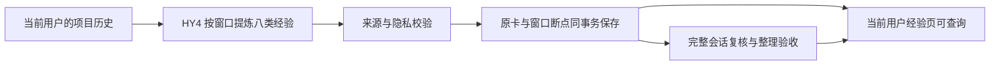

# 历史经验逐批保存与查询

历史提炼不再等待整轮完成才导入。每个完成窗口通过来源、结构和隐私检查后，原经验卡、全部来源关联和窗口断点在当前用户正式数据库的同一事务保存。后续额度中断时，从尚未完成的窗口继续；单个窗口失败不回滚其他窗口。

整理状态与验证状态分开记录。整理验收通过仍是候选，成功计数为零，不自动进入已验证召回。完整源会话、后续纠正和原卡哈希共同约束整理验收；模型自行报告完成不构成独立验证。

多项目会话中的项目列表是来源上下文。没有明确的单一卡片归属时，完整材料先保存并可查询，不取列表第一个项目、不复制成多个经验。原版本和父版本保留，已删除或被替代的版本不因重放恢复。

四张附加表分别记录窗口、经验材料、窗口与卡片关系、版本父关系。写入按 owner、源快照、会话、窗口及规则版本幂等；相同身份出现不同结果时拒绝冲突。写入端由运行中的服务配置和库登记解析实际用户数据库，不接受网页传入的路径。

前端沿用经验页，默认查看本次历史提炼，可按八类经验、来源项目、整理状态、验证状态及关键词查询。详情显示问题、解决步骤、关键改动、结果与原文依据。用户知识库的经验计数与默认资料列表一致。

读取通过现有用户库权限路由。集合与详情额外核对材料 owner；跨用户授权仍分方向、历史与经验分别控制。读取不创建表、不运行模型、不初始化索引，也不写验证证据。网页没有新增经验写入接口。

验证包括正式导入模块的事务回滚、幂等、版本与删除门禁；只读 API 的用户隔离、筛选与分页；浏览器的原文转义、候选不伪装已验证、响应布局与既有有向权限回归。
