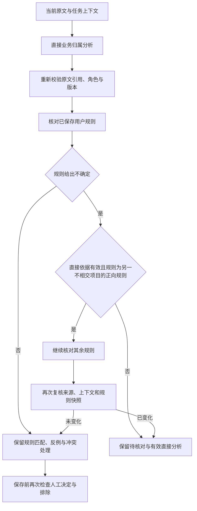

# 用户规则的不确定结论按适用范围处理

同一条资料先依据当前原文、已核对任务上下文和项目登记表判断直接归属，再核对已保存的用户规则。某条规则“不确定是否属于另一个项目”，不等于本条所有项目归属都不确定。

只有同时满足以下条件，另一项目规则的不确定结果才不会挡住直接归属：

- 直接分析为当前有效的 `include`，范围是明确登记的项目；项目集合必须与有原话支持的 `owner` / `applicable` 目标完全一致。
- 当前单位、原始任务、清洗版本、规则版本、分析版本和上下文指纹仍相符；单位原文能按冻结任务的原文范围重构，逐字引用及业务过程重新通过校验。
- 该规则是正向项目规则，且其全部适用项目与直接归属项目集合没有交集。共享知识必须对每一个适用项目都满足不相交。

全局规则、负规则、同项目或交叉范围的不确定仍需核对。真实反例、多个命中规则的范围冲突、人工排除、人工归属和前序未解决的人工决定继续保护。仅含项目名、客户端归档标签、候选向量分数或未经校验的缓存分析不能获得例外。

`ownership_reasoning.current_direct_analysis(service, unit, analysis)` 是纯读验证，不发模型请求。它保留当前前驱依赖；前驱原文或人工决定改变后，旧分析失效。`organization_semantic_review.classify_guidance(..., direct_analysis=None)` 仅接收已算出的分析，并报告本轮忽略的不确定规则 ID。没有直接分析的调用继续使用原来的保守语义。

`_assign` 的规则待审分支保留重新验证通过的直接分析，帮助解释“原文支持什么、哪条规则仍待核对”；单位本身仍为 `review`，这份诊断不确认项目，也不授予召回资格。

验证使用真实临时 SQLite、归档原文与当前版本，只替换外部模型响应。覆盖同任务原话跨片段引用、同范围/交叉范围/全局/负规则、共享适用、冲突命中、缓存引用篡改、原文/规则/前驱变化、人工排除和人工决定保护。生产部署及历史任务重试由独立运行收据记录；此修复不会自动清空待审队列。
