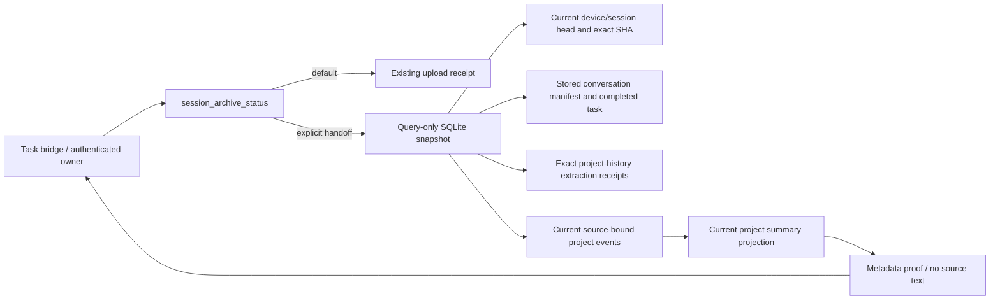
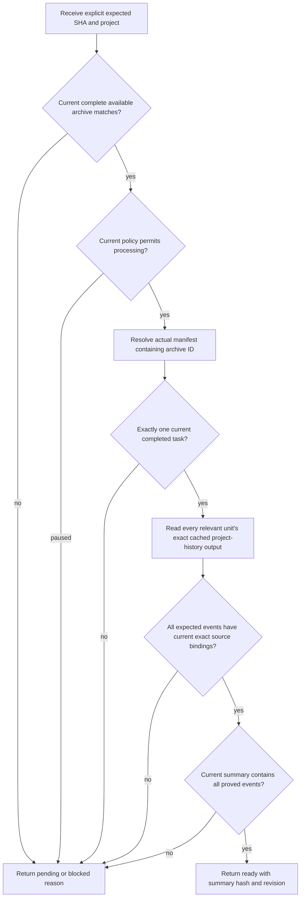
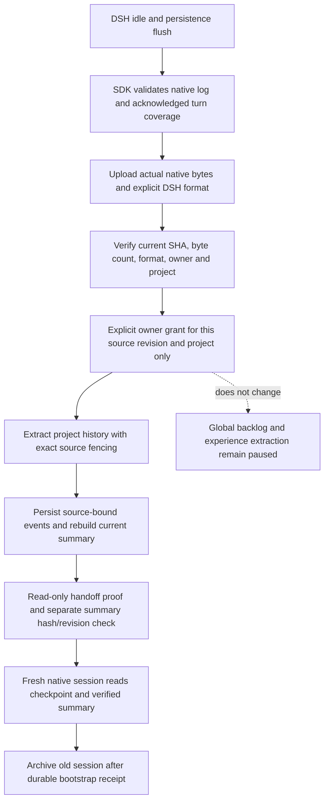

# Task handoff source proof

`session_archive_status` accepts an optional `handoff` object. Omitting it retains the original status contract and work. The owner-authenticated LAN dispatcher selects the personal store; callers cannot choose a user or database.

```json
{"device_id":"registered-device","session_id":"native-session","handoff":{"sha256":"<64 lowercase hex>","project":"registered-project"}}
```

The response retains the ordinary archive fields and adds `handoff`:

```json
{"schema_version":1,"state":"ready","reason":"","archive_id":1,"source_sha256":"<hash>","project":"registered-project","source_key":"conversation:<manifest>","task_id":2,"source_revision":"<revision>","task_status":"completed","source_current":true,"covers_source":true,"summary":{"project":"registered-project","revision":3,"sha256":"<rendered-summary-hash>","event_ids":[4]}}
```

All identifiers above are synthetic placeholders. No source prose, credentials, paths, prompts, or event content appear in this extension. `summary.event_ids` lists the events proved for this exact archive, not every event in the project. `summary.sha256` hashes the complete current project summary returned by `project_archive_get`, including other current sources. The bridge must compare that content hash and revision with the separately retrieved summary; a concurrent change requires a fresh proof, never a relaxed comparison.

## Architecture



`evolvmem/lan_handoff_status.py` owns proof evaluation. `lan_capture.py` adds only the optional schema and dispatch hook. Existing provenance readers check live source revision, unit text/range/digest, confirmed project ownership and current event support. The snapshot uses SQLite query-only mode and rolls back its own read transaction; it never borrows a caller write transaction. The read-only proof itself never initializes schema or invokes a provider; the native capture and explicitly authorized processing additions below have their own deployment schema gates.

## Activity flow



Primary project history and the legacy extraction rollup are different pipelines. A legacy `project_summary_status=ready` alone is insufficient. The latest `source_watermark` is also insufficient: it is a task source key, and another task may legitimately advance it while retaining the earlier source. This proof follows actual manifests and all current event bindings instead.

Missing tasks/receipts/events/summary are explicit pending states. Changed source, ownership, wrong hash/project, missing binding, ambiguous task, empty event output, or disabled processing are explicit blocked states. Empty extraction is retained as evidence but does not manufacture a project milestone or count as a proven summary update. The endpoint never enrolls sources, retries extraction, enables automation, or processes historical backlog.

## Validation and release boundary

Synthetic tests cover default compatibility, owner isolation, exact archive/project/hash, missing/incomplete tasks, source mutation, exact cached output, withdrawn event/binding, empty output, intentional pause, later same-project updates, and query-only write prevention. Existing capture regression tests run under a temporary test-only policy; the live policy is unchanged.

The shared live checkout already contains many unrelated changes. Original modified-file baselines and the exact task patch are retained outside the repository at `/tmp/task-ai-evo-handoff-baseline`. No service restart, push or deployment is included in this change. Release requires review of this isolated patch, required browser fixture checks/screenshots and a deliberate deployment slice. Existing live services continue running their current loaded Python code until that gate is completed.

### Observed validation (2026-11-10)

- `EVOLVMEM_PRODUCT_POLICY_FILE=/tmp/task-ai-evo-handoff-baseline/test-policy.json .venv/bin/python -m pytest -q tests/test_lan_handoff_status.py tests/test_lan_capture.py`: **38 passed**. Fourteen new proof tests use temporary synthetic stores and an isolated policy. The real policy is untouched.
- Automation maintenance container adapter/runner tests: **39 passed**, including missing/wrong proof refusal and a concurrent summary hash/revision change requiring a fresh proof.
- Required `tests/browser/product_modules.e2e.cjs` executed against the new synthetic loopback fixture at port 39681. It stopped at the existing experience-page selector `#experience-filters [name=status]`, before reaching principles. This unrelated full-suite failure remains a release gate; the test was not weakened.
- Focused read-only fixture browser check: new explanation and flow present at 390/768/1440 px, no horizontal overflow or JavaScript errors. Desktop/mobile screenshots inspected for readable text and complete cards. Evidence directory: `/tmp/task-ai-evo-handoff-browser-20261110/screenshots`.
- The temporary browser contexts and fixture process were closed. No production model request, history enqueue, policy change, service restart or push was performed.


## Native DSH source and explicit one-source processing

`session_archive_upload` accepts optional `source_format`. The default `codex-jsonl` preserves Codex clients. `dsh-session-jsonl-v1` means the original UTF-8 DSH v4 JSONL file, beginning with its native `type=session` header and followed by contiguous `seq` events. DSH 0.2.0-rc.2's installed format catalog is the authority for physical fields. The bridge waits for `agent.whenIdle()`, flushes JSONL persistence, reads through the SDK validator, and snapshots the actual uncompressed file. It verifies that acknowledged native turns and tools are covered before handoff. No Codex wrapper, reconstructed transcript or text-only substitute is accepted.

All original user, assistant, system, developer, tool, stream, usage and other native event bytes stay in the encrypted archive. `conversation` is a separately derived display/organization view; it is never the archived source. Source format, total byte count, SHA-256, current snapshot order and personal owner must agree. Source format is fixed from the first chunk of a version, and the same format is returned in the upload/status receipt and explicit handoff proof. The first DSH format deliberately refuses seeded/forked sessions: this runtime creates independent fresh sessions, and inherited-cut handling is not silently approximated. Native subagent sources are archived but excluded from project organization.

`transcript_formats.py` dispatches formats, `dsh_transcript.py` checks the native physical envelope, and `lan_capture.py` preserves the raw encrypted source with adapter `dsh`. Existing Codex continuity backfill does not interpret DSH events; task windows save their explicit continuity checkpoints. Capture adds a defaulted `source_format` column on initialization, so deployment must include a reviewed schema/startup gate. No live database was initialized or migrated while developing this change.

The generic global processing pause remains effective. An explicit owner-authenticated `session_archive_process_history` call grants only project-history processing for the exact `device_id`, `session_id`, `archive_id`, `sha256`, server-derived `source_revision`, registered `project`, and `source_format`, with a stable `request_id`. The bridge first requires this tool to be advertised. Older servers fail closed. This grant does not enable general extraction, experiences, capabilities, project modules, other sources, or backlog. The server must revalidate the exact source before and after provider work and persist the normal project-history source/event receipts. A lost or unresolved provider outcome is not automatically replayed.



A completed scoped grant can establish proof while legacy extraction still reports `processing_state=paused`; the DSH client uses that exact scoped proof, not legacy rollup status. Without a valid scoped grant, disabled global policy still returns the explicit `ai_processing_disabled` / `project_history_processing_disabled` blocker. Missing, stale or ambiguous source evidence remains pending/blocked; no milestone, completed task or summary inclusion is manufactured.

DSH-only baseline and patch evidence are under `/tmp/task-ai-evo-dsh-baseline-20261110`; this is a separate slice over the earlier handoff-proof candidate. No service restart, live model request, push, global policy toggle or historical queue processing is part of this slice.


### Native DSH slice validation (2026-11-10)

- Joint native-format/capture/handoff/scoped-history tests: `EVOLVMEM_PRODUCT_POLICY_FILE=/tmp/task-ai-evo-handoff-baseline/test-policy.json .venv/bin/python -m pytest -q tests/test_dsh_transcript.py tests/test_lan_capture.py tests/test_lan_handoff_status.py tests/test_task_history_processing.py`: **69 passed** in isolated synthetic stores.
- Bridge adapter tests, run inside `automation-project-ssh` with `PYTHONPATH=src`: **40 passed**, including DSH bytes/tag checks, incomplete native turn/tool rejection, unsupported server refusal, exact source grant, paused legacy acceptance only with completed scoped proof, and no second request after unknown scoped timeout. DSH upload sets `extract=false`; the explicit source-only call receives the remaining bounded archive timeout budget.
- Required product browser suite ran against a new synthetic HTTP fixture and stopped at its stale navigation assertion (`6 !== 5`, line 21). This unrelated baseline mismatch remains a release gate; no test was weakened. Focused principles checks passed at 390/768/1440 px with no overflow or page errors; desktop/mobile screenshots were inspected. Evidence: `/tmp/task-ai-evo-dsh-browser-20261110`.
- The temporary fixture was terminated. These results do not claim a production model call or live deployment.

- Installed DSH SDK cross-check: a deterministic synthetic model adapter generated a real native v4 file with 17 rows / 4544 bytes, including native request/context/header, inbox splice, system, tool and terminal events. Its SHA-256 is `7e3e0a037a2e6c499aa2b8f534ed7434fbc471d805f30ea5b8d6f5501151abde`. Evo archive preservation and the maintenance-container completion validator both pass against the unchanged fixture; no external model was called.
