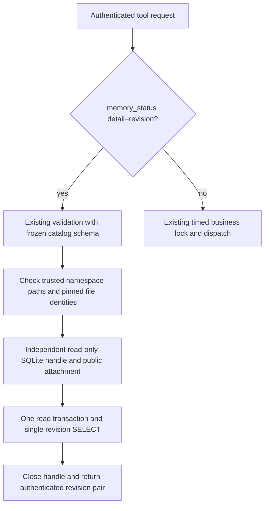

# Authenticated LAN revision polling

`memory_status` with exactly `detail=revision` validates the same identity,
space, reference and argument contract as other LAN calls. Its result remains
`detail`, `authenticated_user` and `memory_revision` (`personal.public`), including
when the requested space is public. Invalid inputs still fail validation.

The adapter pins namespace files from trusted `LanSettings` after runtime
initialization. It rejects path/inode replacement and namespace aliases, including
hard links, rather than mixing resident old handles with a replacement database.
An intentional database replacement requires adapter reinitialization. No client
argument can choose a database. Missing files are never created by polling.

The poll does not access resident stores, mutable workspace identity, schema
initialization, models, indexes or health scans. SQLite handles close on both
success and failure. Each open is read-only (`mode=ro`); the attached read is
also protected with `query_only`. Busy waiting is limited to 100 ms per SQLite
operation and a 250 ms progress deadline bounds SQLite VM work; this is not an
OS/filesystem I/O deadline. Safe failures retain `remote_tool_failed`.

The read transaction and single SELECT observe committed namespace snapshots,
never another connection's pending write. Separate WAL namespaces retain SQLite's
per-database snapshot semantics; this does not introduce distributed commits
between personal and public databases. Revision polling asserts no health or
business-readiness guarantee. Every other business request keeps its existing
serialization. Dispatch timing includes the revision read; polling reports no
business-lock queue stage because it does not enter that queue.
