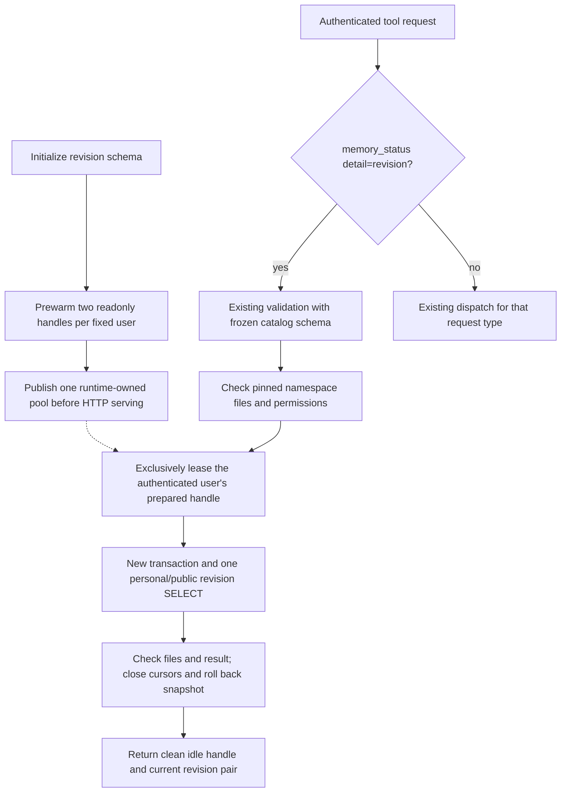

# Authenticated LAN revision polling

`memory_status` with exactly `detail=revision` validates the same identity,
space, reference and argument contract as other LAN calls. Its result remains
`detail`, `authenticated_user` and `memory_revision` (`personal.public`), including
when the requested space is public. Invalid inputs still fail validation.

The runtime owns four prepared connections: two each for the two configured LAN
users, with each pair attached to its own personal database and the public
database. It does not cache revision values or authentication. Other independent
readers retain their own request connections. `RevisionReader` remains a
connection-free identity checker on construction; only the explicit startup
`prepare_revision_reader()` creates the pool. Its getter refuses an unprepared
runtime. Concurrent adapters share one published pool.

Every handle uses `mode=ro`, `query_only=ON`, `trusted_schema=OFF`, a 16-statement
cache, no mmap, and a 256 KiB page cache for each attached database. These cache
settings do not cap all SQLite schema/connection memory. Fixed connection count
bounds handle growth. A connection is exclusively leased to one request.

The pool pins resolved path, device/inode and mode/uid/gid for all three namespace
files. Replacement, permission changes, inaccessible files and namespace aliases
fail closed. Intentional replacement requires controlled runtime reinitialization.
Request arguments cannot select a file. Reads never reconnect, reattach, rebuild a
retired slot or adopt a different file identity.

Requests retain the 100 ms SQLite busy timeout and 250 ms progress deadline.
Waiting for a handle consumes that deadline and is separately limited to 50 ms.
Startup uses a separate 1 s SQL budget per prepared connection. Neither budget
is a hard OS/filesystem I/O deadline. Late success is rejected after cleanup too.
Safe failures retain `remote_tool_failed`.

Each lease begins a new transaction and executes the original single revision
JOIN. Every cursor is closed. Cleanup removes the progress callback before
rollback and verifies there is no transaction, no write, and unchanged safety
pragmas. BUSY/INTERRUPT or schema-query failures may reuse a successfully cleaned
handle; failed cleanup retires it without online replacement. An idle pool does
not pin WAL snapshots. Runtime close wakes waiters, closes idle handles and lets
each active request close its own handle before it exits; it never closes an
in-use SQLite handle from another thread.

The query sees committed namespace snapshots, never another connection's pending
write. Separate WAL namespaces retain per-database snapshot semantics; this does
not introduce distributed commits between personal and public databases.
Revision polling asserts no health or business-readiness guarantee. Diagnostics
report only fixed phases and numeric SQLite error codes, including pool waiting
and cleanup; no query text, paths, tokens or database error text is added.

Linux validation covers cold ATTACH interruption versus warm reads, fresh commits,
uncommitted-write isolation, user separation, schema changes, permission/path
changes, WAL release, callback cleanup, fixed capacity, retirement, deadlines,
startup/shutdown races, unique runtime publication and original authentication
and DTO contracts. Production latency and resource stability require separate
post-deployment measurement.
