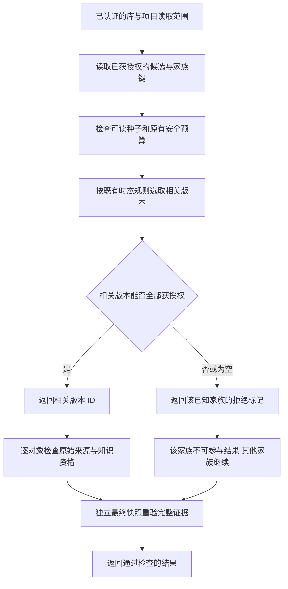

# 历史记忆家族的资格与隔离

## 目的与范围

修复 PostgreSQL 迁移候选中一个已确认的问题：同一家族里已退出、不会参与任何时态判断的旧摘要，只因不在当前读取范围内，便使当前版本及同批其他家族一起报错。

旧版本继续保存。此修复只改读取资格与必要函数授权，不清洗、重提炼、删除或重编码原始资料，不切换正式 SQLite。

## 读取流程

相关版本的集合沿用已有规则：active；或带 effective_from / occurred_at 的 superseded decision。未带上述日期、已退出的 session_summary 无法成为当前或历史时点的胜出版本，因此不参与本次全员授权判断。未来 active 版本仍纳入保守的完整性检查。

## 安全边界

- SQL006 保留，SQL012 新增 `history_identity_family_qualified`，不修改原始表或原始行。
- 每个家族仍须有已获当前范围授权的种子；仅知道一个外部家族键不能查询它。
- 仍最多 240 个键，累计原始家族行上限 512；超出预算的错误继续传播，不降级为词法成功。
- 真正相关的版本只要存在不可读成员，整个已知家族返回单个不含对象 ID、数量或分数的拒绝标记。
- Python 将拒绝标记纳入 proof，点读及已知家族的知识扩展均不能绕过其否决；其他人工事实规则保持。
- 最终独立快照重新构建并比较家族、来源、知识和正文层证据；标记、来源或权限变化不能继续发布旧结果。
- 新函数的 EXECUTE 精确复制旧函数的既有接收者，PUBLIC 不获执行权限。原 reader provisioning 保留角色安全检查、37 表撤权、INVOKER、search_path 和 ACL，仅增加新入口的一条明确授权。

## 验证时必须区分的概念

`active`、项目成员已确认及 SQL admitted 都不等于来源资格已通过。一条当前摘要即使不再被旧家族版本阻断，仍可能因原始任务退出而 `currently_backed=false`；此时点读必须保留 `not_readable` 和空正文。正文成功的正例应选择独立来源资格已通过的记录，不能为了通过家族回归而放宽来源检查。

点读协议只允许 L1/L2；协议错误字段为 `error`。L0 在资格加载时参与完整性检查，不作为点读协议的成功层。

## 安装与完成边界

SQL012 以旧函数体和属性的精确 preimage 为前提，在单事务内安装；发现已安装或不匹配时拒绝执行，不能盲目重放。安装后必须核对真实函数 owner / SECURITY DEFINER / search_path / ACL、已有普通角色和安装后全新 LOGIN 的权限。

本修复的定向验证不代表整阶段压力、全部召回质量或正式数据库切换完成。更大的测试批次仍受既有依赖预算限制，不得为让测试通过而提高或跳过安全预算。
