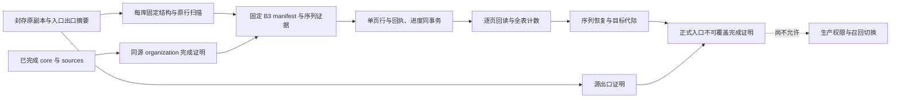

# B3 项目、人工归属与治理账本迁移候选

本候选覆盖固定 26 表、197 个原字段；只执行保真搬运，不调用分类、提取、规则生成或自动整理。没有访问生产正文、运行 PostgreSQL、写入 canonical、发布或激活路由。

依据结构为 `schema-metadata-live-v3.json`（2026-11-01 已采集；SHA256 `f36051b843be978baa56b78c2ca7fee98a8d10bdfc4442832cb4dc711f6eb924`）。本轮窄 SSH 核对 capture 模块及 operator/scope 当前字节，并只读核对现行 `project_modules.py` 的 manual 优先、revision CAS、原绑定字段和 context_store 的原表定义。结构不是本轮实时业务数据或跨库原子快照；源扫描必须重新精确验证本候选中冻结的 DDL、xinfo、FK、索引及缺席表。

## 边界与保真

- owner 26 表；kane/public 16 表。缺少的 10 表通过 schema absence 校验明确记为不适用；源中出现了原本缺席的表即拒绝，不能当成空数据迁移。目标保留统一 26 表；manifest 的 namespace、schema hash 与 applicable set 可区分“不适用”与“存在但为空”。
- `organization_guidance` 各库实际列序不同；扫描用已核对的每库 schema，并按原字段名映射。文本、时间、JSON、人工判定、负面反馈、排除、规则版本、revision、原 ID 均原样保留。
- 原 SQLite 非 INTEGER 主键可能为 NULL，甚至多条 NULL。目标以 `(library_id, source_rowid)` 标识原行，原主键迁为相同 NULL-distinct 的 UNIQUE；不强行把它改成 NOT NULL。INTEGER PRIMARY KEY 的原 rowid alias 另有相等检查。最小有符号 rowid 保留。
- 所有原 TEXT 列为 `COLLATE "C"`，不依赖 PostgreSQL 数据库默认 locale。固定原唯一约束、部分唯一索引、CHECK 和同库外键保留；B3 外键指向 core/source/organization 或本域，未为缺少的未来域添加假外键。
- 四条 AUTOINCREMENT 证据分别保留 present/value，缺席记录与真实 0 区分。最终恢复会超过原已删除行的分配高水位；已耗尽的 INT64_MAX 保存成 `last_value=MAX, is_called=true, NO CYCLE`，未来申请新 ID 继续失败，迁移本身不因不存在的 MAX+1 失败。采用事务性 ALTER SEQUENCE RESTART，再 nextval 消费 MAX；该组合真实 PG 回滚行为尚需必要实库验证。
- 所有业务表保留 owner quarantine 和作用域不可变触发器，账本私有；不授予普通 runtime 访问权。

## 数据流与完成边界

新 `governance` 域父关系是 `core → sources → organization → governance`，无需 capture 父域。每个目标事务再次绑定来源和整理两层完成链；organization proof 精确比对 manifest、source file SHA、父代际、自身代际、next_task_id，且核对其序列未回退。目标页校验前先有界读取 TEXT octet_length，总原文字节超过 4 MiB 时在正文 fetch 前拒绝。源页 128 行/4 MiB、全域 manifest 和原容量红线保持原框架限制。

`prepare/plan/step/status/verify/finalize --domain governance` 已接入候选 operator。目标 `verified` 不是源出口证明；完成仍须 source phase 退出、hash passes>=2、目标代际一致，并生成与 config/source seal/plan 绑定的不可覆盖 proof。没有自动循环或失败重试。

## 本次有限检查

新增本地 3 项通过，约 2.185 秒：包含 owner/kane/public 三种真实 SQLite 小型封存源，原 W.SealedPhase/快照读器、26/16 表、字段列序、NULL 主键重复、最低 rowid、原始文本与已删除 ID 高水位；实际源摘要入口出口一致。测试只 mock 已知生产 inode 列表为空，避免 Windows 查 Linux 路径，不 mock SQLite 读取。仅使用 D 盘临时小源。

独立静态 review 后修正两个路径，只运行新增 2 项，约 0.038 秒：耗尽/未耗尽分配边界；损坏目标超大文本在读取正文前被拒绝。前述 3 项没有重复运行。后续 AST 解析通过。未执行已有全套测试。

这些结果不证明 PostgreSQL SQL/catalog 输出、真实事务回滚/RLS、完整源到目标对账或生产业务适配已通过。下一次必要组合实库验证应明确核对：26 表 DDL、原唯一/CHECK/FK/部分索引的 catalog 表达式、三库缺席结构、页/回执/进度原子性、事务性序列耗尽恢复与回滚、代际变动拒绝及 source proof。不要先启动生产 migration。

## 集成清单

`manifest.json` 仅列 11 个实际新增/改动的候选代码与资源；不要复制候选目录中为本地导入准备的未变化依赖。新增 9 文件：6 个 Python 模块（mapping/scan/plan/importer/constraints/runner）、2 个固定 JSON 资源、1 个 SQL。修改 2 文件：operator 与 scope。另带本说明和新测试。`build_candidate.py` 为固定候选生成/审计工具，不作为运行时 SQL 转换入口。

需合并后的正式原生最小检查与必要实际 PG 验证，再更新整体覆盖矩阵。当前不能据本候选宣称真实历史的 49 表已迁移，生产仍使用原存储。业务读写适配、完整权限、增量追平、跨库召回和最终切换属于原目标剩余项。
