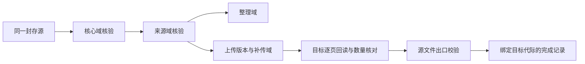

# Capture 域私有 operator 接入

本轮接入 `lan_session_uploads`、`lan_session_heads`、`lan_session_backfills` 三表的既有有界迁移内核。它依赖已 verified 的 core 与 sources；organization 仍与 capture 平级，仅依赖 core 与 sources。原三个域的计划元数据、loader 调用和准备范围保持原语义，新增 capture 不成为旧 organization 计划的新前置条件。

源文件从封存时起就必须包含 capture 三表及同源父域。不能给之前已经封存的二十表合成样本追加表后沿用旧 seal 或计划；验证两条分支时应从创建起使用包含所需二十三表的新合成源。真实历史源本来包含三表时，可在同一个可信 seal 下继续该域。



在原私有配置和工作目录下逐条运行：

```text
python -m evolvmem.history_migration --config /private/operator.json preflight
python -m evolvmem.history_migration --config /private/operator.json prepare --domain capture
python -m evolvmem.history_migration --config /private/operator.json plan --domain capture
python -m evolvmem.history_migration --config /private/operator.json step --domain capture --max-steps 8
python -m evolvmem.history_migration --config /private/operator.json status --domain capture
python -m evolvmem.history_migration --config /private/operator.json finalize --domain capture
```

每次 step 仍只执行一个域、1..32 个工作步骤；是否再发下一条由操作员根据进度决定，没有自动循环或重试。`verify` 使用同一有条件 finalize 路径。未完成目标 readback/count frontiers 时返回 incomplete。

`prepare capture` 先从已提交的私有 core/sources 元数据加载可信 sources 计划，检查同 source seal，再仅应用 `001_history_capture.sql`。父计划的 run ID 与 SHA256 填入 SQL 的 `parent_run_id` / `parent_manifest_sha256`；实际父域 verified 状态、generation 和正式目标 persisted binding 仍由目标数据库门禁复核。缺父计划或 seal 不符在任何注册/DDL事务之前拒绝。

public namespace 原本缺少这三张表，明确不适用。其 capture prepare 在加载父计划和打开数据库之前返回 `capture_namespace_not_applicable`；preflight 额外报告 `capture_applicability=not_applicable`，`domains.capture=false`，原三个域仍使用布尔 readiness。不得为 public 准备空表再把它记作成功空导入。owner/kane 沿用 reviewed schema、25 个原字段、原 rowid、NULL head 与有限 REAL/raw JSON 的既有校验。

capture 的 loader 使用真实四参数接口 `load_plan(path, sha, parent_sources_plan, runtime(config).target)`，Target 来自可信私有配置；不从计划 JSON 重建授权对象。外层 capture 元数据继续绑定 config hash、source seal、确定性 run ID 和 core/sources 父计划哈希，格式仍为 version 1。

step 直接复用 `run_capture_batch.run_batch`。独立 finalize 在 readiness 成立后同样调用该 runner（max_steps=1），要求新的 capture phase 入口和出口完整证明，成功退出源 phase 后才提交目标最终状态。没有将单独 importer 返回的 `target_domain_verified=true` 解释成源完成。

完成后写入独立不可覆盖的 `plans/capture-<manifest-sha256>.proof.json`。proof 绑定 config、source seal、plan hash 与 target generation。发布之前，在源 phase 已关闭后另开短 status 事务复核完整 frontiers 与 generation/verify_generation；不在源 hashing 时持有目标或控制库连接。status 同时要求目标 verified、完整进度与相同 generation proof，普通 target verified 或失败的源出口证明不足以返回 domain_complete。proof 不改变旧域计划元数据。

原私有目录、非阻塞 OS 锁、唯一 durable attempts、源/SQL/外层 deadline、未知提交后停止、不泄露 SQL/secret 的错误码及所有 closed flags 继续生效。history_complete、route_activated、production_migration_proven 始终 false。配置容量 guard 仍仅读取执行机 capacity_path 与 `/proc/meminfo`；实际部署须在内容 PG 同机、确认路径覆盖真实 data/WAL 存储和投影 reserve，不能将这些读数解释成任意远程 PG 容量验证。

新增定向检查位于 `tests/test_capture_operator.py`，可迁至 canonical `tests/pg_history_capture_integration/`；资源由包解析，临时目录接受 `EVOLVMEM_TEST_TMP_ROOT`，Windows 默认 D 盘。初始红为 capture 域/prepare 未接入，随后专门复现了 target-generation proof 漂移与 public 适用性遗漏，再实现修复。

这些操作编排检查使用 fake target/kernel ports；runner 生命周期检查调用真实 capture runner，但其源 phase 与数据库 port 是测试替身，确认源出口先于 finalize、出口失败不 finalize。loader 检查核对真实四参数调用。它们不是实际 PostgreSQL 验证，也不是实际历史导入。真实小型 sealed SQLite capture reader 的证据由本轮独立 package 检查提供；root 负责最终 pin closure、Linux 新增检查与后续实际 PG 资格验证，不重跑旧二十表/29项全套。
