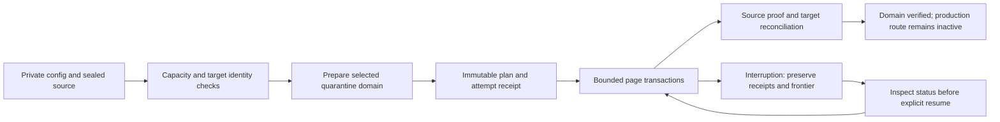

Private historical migration operator candidate
==============================================

This candidate adds a local module entry point, not an HTTP tool. It cannot
activate a route or declare full history complete. Formal historical migration,
incremental catchup, full recall, load verification and cutover remain separate
unfinished work. Install/integrate the candidate package and its pinned kernels
before using the commands; this artifact alone is not a standalone deployment.

Production configuration loading requires Linux private ownership and permissions.
Use the exact JSON schema accepted by `operator_config.load_config`, with an
absolute private config path and a precreated private work directory (0700).
Password files and CA references remain in that private config. Never put a DSN,
password, history text or SQL into a CLI argument. The target must already have
its registered quarantine/control identity; this operator creates no principals,
starts no services and changes no active routing.

Capacity checks measure only the operator host: free space on `capacity_path`
and available memory from `/proc/meminfo`. Run the operator on the content
PostgreSQL host and point `capacity_path` at its actual data/WAL storage.
The configured TLS hostname does not prove that the database is on this host;
this implementation does not measure an arbitrary remote server's capacity.
If data and WAL use different filesystems, this single-path guard is insufficient
until both storage budgets are checked by the deployment process.
Set `peak_reserve_bytes` to cover the projected remaining growth, including data,
indexes, WAL and temporary work. It is an explicit capacity estimate, not an
automatic estimate or a guarantee supplied by a positive number. The operator
refuses work when free space minus that reserve is below 30 GiB or available
memory is below 2 GiB. Preserve the original source and recovery copy throughout.

The supervised entry point is:



```
python -m evolvmem.history_migration --config /private/operator.json preflight
python -m evolvmem.history_migration --config /private/operator.json prepare --domain core
python -m evolvmem.history_migration --config /private/operator.json plan --domain core
python -m evolvmem.history_migration --config /private/operator.json step --domain core --max-steps 8
python -m evolvmem.history_migration --config /private/operator.json status --domain core
python -m evolvmem.history_migration --config /private/operator.json finalize --domain core
```

Each `step` is one explicit command for one domain, with 1..32 work steps. Inspect
status and issue the next explicit step only after reviewing the prior result.
Verification/finalization reports `incomplete` until database frontiers cover all
planned pages and all target counting work. `verify` is an alias for this guarded
finalization. A completed step may finalize its selected domain after a successful
source exit proof; it still reports history/production/route completion as false.

After verified core, run `prepare --domain sources`, then plan/step/status/finalize
for sources. After verified sources, run `prepare --domain organization` and its
plan/step/status/finalize. Preparation applies only that domain's pair of schema
migrations and preserves SQL parent verification gates. Preflight is read-only.
Planning uses the retained source offline and parent plan metadata; it opens no
database connections. Status requires an already registered run and prepared
schema; a missing run returns a safe stopped code rather than starting it.

Every command obtains a nonblocking OS-held lock on the private work directory.
Attempt UUID files under `attempts/` are created exclusively and fsynced. Every
started attempt is retained alongside its success or safe failure record. Plans
live under unique attempt filenames, with a separate immutable per-domain commit
metadata file binding the config hash, source seal receipt, deterministic run ID
and all parent plan hashes. Failed/interrupted planning leaves its artifacts
intact; a new explicit plan attempt uses a new filename. A committed domain plan
cannot be replaced. Configuration or parent drift is refused.

The outer CLI process enforces `command_seconds` (1..300); each source phase is
at most 60 seconds. The worker flag is internal to the supervisor. On deadline,
interruption, unknown commit or other error, no retry occurs. Review retained
receipts, then inspect database status before explicitly resuming. A timeout may
leave committed quarantine pages; a local failure record never proves rollback.
Kernel frontier/readback checks determine progress. Do not delete old receipts
or mutate an existing plan to force progress.

The existing core and sources bounded runners supply real page operations.
Organization uses one shared `Importer.batch` per source phase; target transactions
close between steps, and finalization is called only after batch exit. Full source
hashes therefore run outside control/content transactions. Status uses the
organization importer's existing gated target-stage/progress methods because the
kernel has no public organization status method.

Focused local evidence (2026-11-01)
---------------------------------

`python artifacts/pg-history-operator-20261101/tests/test_operator_cli.py`

Initial red: five failures asserting the missing bounded entry point. The focused
set currently has ten passing checks. Additional red/green checks covered unique
plan-attempt binding after interruption and domain-specific preparation.

The core planning check reads and hashes a new tiny SQLite WAL fixture through the
actual sealed-source and planning implementations, verifies actual source file
hashes remain unchanged, and rejects any runtime opening. Only discovery of the
known active source inode set is a metadata test port. Directory privacy checks
are mocked on Windows for orchestration tests; Linux ownership is not claimed.
Other checks use fake kernel/target ports to verify lock exclusivity, durable
attempts, bounded dispatch, config/dependency drift, safe failures, interruption,
incomplete finalization and organization batch exit ordering. These are not real
PostgreSQL verification or proof of successful historical migration. No real
archive, production source, SSH, service operation or PostgreSQL startup was used.
The supervisor deadline test injects a subprocess timeout and verifies retained
started/unknown receipts and a single dispatch; it does not wait for a real blocked
database driver or prove operating-system child termination under load.
