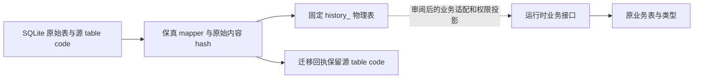

# 历史原始表与运行表的物理名称分离

候选基于已核实 248 路径 inventory `6fa23f677ec1ba1c610595e26a7bbf44b93505ddb94bc018d3fda8d2a2c5b8c2`。只修改候选目录；未启动 PG、服务或改动 canonical/生产。

## 症状与根因

九域组合前发现三张历史表重复创建业务底座已有的同名运行表，字段及含义并不相同。历史核心迁移依赖业务底座版本和已有核心表，不能省略 business core，也不能通过 DROP 或 IF NOT EXISTS 忽略结构差异。

| SQLite 源代码/原始表名 | 历史目标物理表 | 保留的运行表 |
|---|---|---|
| context_project_aliases | em_content.history_context_project_aliases | em_content.context_project_aliases |
| context_project_workspace_bindings | em_content.history_context_project_workspace_bindings | em_content.context_project_workspace_bindings |
| lan_write_requests | em_content.history_lan_write_requests | em_content.lan_write_requests |

## 修复范围

两个 mapper 新增固定 `TARGET_NAMES`、`TARGET_TABLES`、`target_table`；SQLite schema、源 TABLES、原始字段/ID、canonical/chunk hash、计划和 ledger table_code 仍使用原名称。改写仅发生于目标 INSERT、读取、计数、空目标检查、锁、catalog/table constraints、DDL 和隔离/代际触发器绑定。三张改名表均不在 AUTO 集合，原有序列与高水位恢复名称保持原样。

治理约束合同的原名称、索引/约束名保持不变；比对 catalog 时将关系名转换为固定物理名。业务底座 SQL 没有改动。源预算修复未回退，因为本候选没有替换 scanner/helper。

operations 既有 `test_transaction.py` 的目标建表、触发器和历史 result 查询已同步物理名；`test_fidelity.py` 仅同步安全触发器 catalog 预期目标名，源存储类型检查仍遍历源 TABLES。既有完整套件未重跑。

## 验证

- `audit_creates.py` 核对 15 份固定 SQL（九域所有历史 DDL，加 foundation/content 与 business core）的原始 pin。原来只有这三处 CREATE TABLE 冲突，候选组合后重复创建集合为空。
- 三项新增聚焦检查：真实 SQLite 内存库中保留运行表 sentinel，再插入三张独立历史表，全部原值读回一致，源 chunk hash 与原 mapper 相同；检查 ledger 源代码不变；检查目标 catalog/query 使用固定映射。
- 首次运行 2 项通过，另一项测试误将 `AFTER ... TRUNCATE` 触发事件识别为删表语句。把断言收窄到 `DROP/TRUNCATE TABLE` 后，仅重跑该失败项，0.024 秒通过。没有重复前两项。
- Python AST 解析通过。没有 PostgreSQL 执行；这些结果不能证明实际 SQL/catalog/事务/RLS 验证完成。

## 架构与边界

本候选只修尚未实际部署的新域建表过程，不是已有历史 PostgreSQL 数据库的自动升级脚本。旧 fixture 保留，不能删除或覆盖后重建来掩盖差异。

现有 runtime 继续访问自己的原表。后续读取历史别名、工作区绑定或旧请求回执时，必须使用明确的 history mapper/adapter 和权限投影；不能把空运行表当成全部历史，也不能将旧请求账本直接当作可重放的当前幂等请求。是否晋升业务资格、历史 ACL 回填等由后续接线阶段处理。

交付文件与 before/after SHA 见 `manifest.json`，静态冲突证据见 `ddl-collision-audit.json`，新增检查在 `test_separation.py`。
