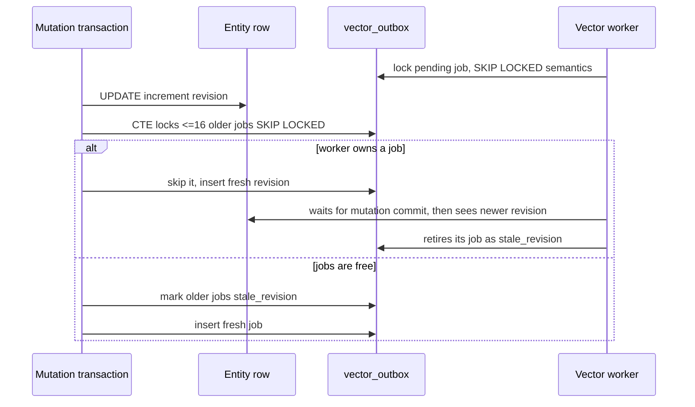

# Native outbox stale-revision retirement

Status: candidate code and SQL-boundary tests only. No PostgreSQL execution,
live SQL, service start, credential use, DDL or repository write was performed.

## Scope

`PgBusinessCore._pending()` now retires a bounded page of older pending native
jobs in the **same transaction and statement** that inserts the fresh job. It
covers the existing fixed-index enqueue used by `legacy_add`,
`legacy_replace`, `legacy_remove` and native context mutation paths.

Only rows matching all of the following are changed:

- `library_id` and `project_id` equal the authorized `ProjectScope`;
- `index_kind`, `entity_id` and `model_contract` equal the fresh enqueue;
- `status = 'pending'`;
- `entity_revision` is **strictly less than** the fresh row revision.

At most 16 rows per enqueue are selected, ordered by `id`, with
`FOR UPDATE SKIP LOCKED`. Rows are retained. Only the receipt columns change:

```sql
status = 'stale',
result_code = 'stale_revision',
processed_at = clock_timestamp()
```

No action filter is added: both `upsert` and `remove` jobs for an older revision
are retired. Equal and newer revisions are disjoint from the predicate, so the
fresh insert and any equal-revision idempotent retry remain pending.

## Statement shape

The implementation uses one parameterized statement. The `marked` CTE is a
data-modifying CTE and is executed even though the final `INSERT` does not
reference it.

```sql
WITH retired AS (
    SELECT id
    FROM em_content.vector_outbox
    WHERE library_id = $1
      AND project_id IS NOT DISTINCT FROM $2
      AND index_kind = $3
      AND entity_id = $4
      AND model_contract = $5
      AND status = 'pending'
      AND entity_revision < $6
      AND $7
    ORDER BY id
    LIMIT 16
    FOR UPDATE SKIP LOCKED
), marked AS (
    UPDATE em_content.vector_outbox j
    SET status = 'stale',
        result_code = 'stale_revision',
        processed_at = clock_timestamp()
    FROM retired r
    WHERE j.library_id = $1
      AND j.id = r.id
      AND j.status = 'pending'
    RETURNING j.id
)
INSERT INTO em_content.vector_outbox
    (library_id, project_id, index_kind, entity_id, action,
     entity_revision, content_hash, model_contract, created_at)
VALUES ($1, $2, $3, $4, $8, $6, $9, $5, $10)
ON CONFLICT (library_id, index_kind, entity_id, entity_revision,
             action, model_contract) DO NOTHING;
```

`$7` is the proof gate. It is always a bound boolean, never interpolated SQL.
`$9` is the existing `sha256(content or '')` value; the inserted action, hash
and conflict semantics are unchanged.

## Context L0 proof gate

For `index_kind = 'context'`, the enqueue already reads the item revision and
must also prove the current L0 row before $7 can be true:

- exactly one L0 row;
- `content` is a string;
- `content_hash == sha256(content)`.

If the L0 row is missing, duplicated or corrupt, retirement is disabled for
that enqueue. The existing fresh insert still follows its prior path, so the
worker's existing `context_layer_proof_invalid` failure remains the
fail-closed boundary. No old pending job is silently discarded on bad proof.

Legacy enqueue keeps its existing row lookup and content hash behavior.

## Permission and trigger compatibility

Confirmed against the read-only source:

- `grant_runtime.sql` grants runtime `SELECT, INSERT, UPDATE` on
  `em_content.vector_outbox`; no `DELETE`, DDL or trigger grant is needed.
- `002_business_core.sql` enables/forces RLS and has `authorized_read`,
  `authorized_insert` and `authorized_update` policies using
  `em_security.allows(..., 'write')`; the mutation caller is already inside
  the authorized write transaction.
- `vector_job_receipt_check` permits `stale` only with a non-null
  `processed_at` and `result_code = 'stale_revision'`.
- `keep_vector_job_identity` permits a pending row to change only its receipt
  fields; the update leaves the job identity columns untouched.
- `require_active_vector_job` is an INSERT trigger and is unaffected by the
  UPDATE CTE.

No schema, grants, models, search, expiry or timestamp-gating behavior changes.

## Revision and concurrency behavior

The fresh revision comes from the row just mutated (`revision` is incremented
by the existing mutation SQL, or defaults to 1 for a new row). The update
cannot target that fresh revision because the predicate is `<`, and the fresh
insert is not in the same snapshot for the CTE.

The mutation transaction normally holds the entity row and then wants job rows;
the worker holds a job row and then wants the entity row for `FOR SHARE`.
`SKIP LOCKED` makes the mutation skip a job the worker currently owns instead
of waiting, avoiding that reverse-order deadlock. The skipped job remains
pending; the worker can observe the newer entity revision and retire it through
its existing `stale_revision` path.

Residual risk: `SKIP LOCKED` can leave more than 16 older rows pending when a
worker holds a lock. They are eligible on a later mutation enqueue. That is
intentional and preserves forward progress over completeness.



## Verification performed

- RED: the new bounded test failed on the original insert-only statement
  (`4 failed`); evidence is `evidence/red.txt`.
- GREEN: `candidate/tests/pg_business_core` plus the copied native
  business/idempotency wiring test passed: `26 passed`.
- Existing `test_domain.py` and `test_wire_dto.py` were retained as regular
  candidate copies and passed unchanged.
- Tests use a recorder, not PostgreSQL. They prove the emitted SQL text,
  parameter order, strict revision predicate, limit, lock clause, proof gate
  and unchanged hash/action insert. They do **not** prove PostgreSQL planner,
  RLS or trigger execution.

## Required real PostgreSQL validation (root later)

Run against a disposable synthetic project/library, not live data:

1. Seed >16 pending jobs for one entity/model with revisions below the new
   revision, plus jobs for another entity, project, model and action. Enqueue
   one fresh revision.
2. Assert exactly the 16 lowest eligible ids become
   `status='stale', result_code='stale_revision', processed_at IS NOT NULL`;
   all other rows keep their prior status/receipt. Inspect `processed_at` is a
   real clock time, not null and not reused.
3. `EXPLAIN (ANALYZE, BUFFERS)` the statement. Confirm an index-backed path
   (the existing unique/partial indexes, no sequential scan of the outbox) and
   at most 16 updated rows.
4. Open a worker transaction that locks one old job and the entity row in
   worker order. Run an enqueue concurrently. Assert it does not block, skips
   that job, inserts the fresh job, and the worker later records
   `stale_revision` or otherwise leaves a safe pending state.
5. Re-run the same request id/action: assert the fresh job is not retired,
   idempotent insert does not create a duplicate, and an equal-revision pending
   row is untouched.
6. Force a missing L0 row and a mismatched `content_hash`; assert no old job is
   retired and the existing worker failure path is still observable.
7. Confirm runtime role has no DELETE/DDL and the update succeeds under RLS.

Suggested inspection query:

```sql
SELECT id, index_kind, entity_id, action, entity_revision,
       status, result_code, processed_at
FROM em_content.vector_outbox
WHERE library_id = $1 AND project_id = $2
ORDER BY id;
```
