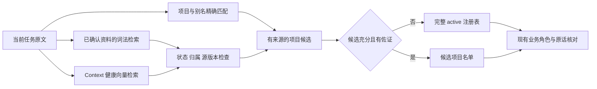

# 项目归属候选召回

状态：隔离实现，尚未接入自动归属调用。2026-10-31。

入口：`evolvmem.ownership_candidates.recall(service, unit_or_text, limit=8, use_vectors=True)`。输入为非空文本，或含 `text` 的任务单元。输出只供现有 ownership_reasoning 阅读，不生成归属决定、不更新注册表、不增加验证成功次数。

## 返回约定

```json
{
  "version": "ownership-candidates-v2-bounded",
  "requires_reasoning": true,
  "candidates": [{
    "project": "example",
    "score": 1.0,
    "evidence": [{
      "origin": "project_exact",
      "source": {"kind": "registry", "project": "example", "revision": 1},
      "ref": "project:example",
      "score": 1.0,
      "quote": "example"
    }]
  }],
  "registry": [],
  "fallback": true,
  "fallback_reasons": ["insufficient_candidates"],
  "diagnostics": {"vector_status": "disabled", "excluded": [], "pool_truncated": false}
}
```

`registry` 是供模型参考的 active 项目名单。候选不足两项、召回分低、领先分差小于 0.1、最高项没有独立来源类型佐证，或候选池被截断时，它包含完整 active 注册表。精确提到的多个项目不会因 limit 被丢弃。limit 最小为 2，不能借它强制 top 1。

候选分是检索排序启发式，不是正确归属概率：项目 ID 精确命中 1.0、别名 0.98、显示名 0.95，单元词法最高 0.7，Context 词法/向量最高 0.65。纯向量无法越过 0.75 的缩小候选阈值。尚无标注集上的准确率/召回率校准证据，不能把这些数值解释为自动确认门槛。

## 证据与来源门

| origin | source.kind | 来源及检查 |
| --- | --- | --- |
| project_exact / display_exact / alias_exact | registry | active 注册表与别名；Latin 标识边界；拒绝单字和 api、项目、数据等短通用词 |
| unit_lexical | unit | auto/manual、keep、明确 project scope、全部项目 active、未 superseded、源版本仍当前；附 task ID、digest、unit/source revision |
| context_fts | context | active、当前有效期、已确认项目；命中的 L0/L1 原文片段，附层名、内容 hash、resolution revision |
| context_vector | context | 复用已有 Context 向量健康/内容契约检查；相同的当前来源与归属门；只检索，不编码文档或写索引 |

Context 的 confirmed 来源可以是当前任务单元，或已保存的人工 resolution。单独的自动项目标签、unresolved/conflict/pending/rejected 结果不能成为代表资料。派生来源失效时，仍有效的独立人工来源可以继续支持同一 Context。失效或未知来源保留在原库，只是不参加此次候选召回。

向量只使用 `service.vector_index`，且路径必须等于 `config.context_vector_path`。通过现有 `ContextRetriever._vector_candidates` 复用向量健康、模型契约及有效 ID 检查；所有 ID 再读 `context_items`。不把 capability memory ID 当作 Context item ID，不读取 capability 标签作为已确认依据。

模型未载入、索引缺失或调用失败时保留词法结果，diagnostics 说明降级。此实现不会初始化模型、重新嵌入历史或修复向量缓存。



## 集成边界

调用者仍须把完整原文任务链、同会话上下文和项目角色交给 ownership_reasoning；候选引用只能帮助定位，不可替代当前任务的 chain/target 原话。不要仅凭 similarity 或候选第一名调用自动归属。候选结果是本次读的快照，不可跨来源版本长期缓存。写入前继续执行原有来源/CAS检查。

每次词法池与向量池最多 100 条，词法分词最多 24 项、最多 13 次 FTS 查询。池满时回退完整项目表；并不宣称已穷尽全部历史证据。当前没有新的持久化候选索引，也没有生产延迟或分类准确率验收结论。能力记忆来源资格由独立 capability provenance 链路负责，本模块暂不把它作为候选索引。

## 子项目 / 业务模块接口建议

现有注册表没有 parent 关系，因此本实现不从 slug、技术分类或相似文本推断层级，不建表、不写 registry。可后续增加独立版本化业务模块目录：

- Module：`module_id`、`project`、`parent_module_id`、`display_name`、`aliases`、`status`、`revision`。
- 模块候选返回 `{project, module_id, evidence, score}`；归属项目与业务模块分列。frontend/backend 等技术标签仍属 capability category。
- 父关系必须显式确认；禁止环、跨项目父子关系及同项目别名歧义；父项归档后的后代状态和父级查询是否包含后代必须先确定规则。
- 模块证据采用相同来源版本与撤回门；不存在已登记模块时返回 `modules=[]` 与原因，不自动新建模块。

## 本次验证

临时数据库、模拟查询向量、实际 FTS/来源读。覆盖精确词/别名、多项目、短词混淆、撤回/过期归属、源版本改变、独立人工来源、L1 后部命中、模型不可用、ID 空间碰撞和零数据库写入。运行：

```sh
/home/jiangli/hermes-memory-plugin/.venv/bin/python -m pytest tests/test_ownership_candidates.py -q
```

## 2026-10-31：有界召回与同批读取

API 增加可选的 `read=CandidateRead(service)`。归属推理每个至多 4 单位的 chunk
只建立一个读取对象，复用 registry、当前来源证明、候选单位和 Context 资格缓存。
对象只属于这一次推理请求；连接的 `total_changes` 或 `PRAGMA data_version` 变化时
下次 recall 丢弃全部缓存，不能跨人工改归属或原文变更沿用旧证明。初始化或召回失败
仍回退完整 active 名录，不能阻断正常归属判断。

默认边界：

- 最多 3 个词法 query，合并后最多验证 100 个不同 Context 候选；向量候选共享这
  100 个验证名额，不能再额外叠加 100 个。
- 词法先按元数据取最近至多 256 个 active project Context ID，再传
  `item_ids` 给现有 search_fts。中文 LIKE 回退必须受这些 ID 约束。
- 单位候选先从 task status 覆盖索引取至多 256 个已决定、keep、未 superseded 的
  unit 身份，再按精确主键读取正文；不再执行全表 `instr(lower(u.text), ...)`。
  SQLite EXPLAIN 回归检查确保不扫描保存巨型 source_snapshot 的 task 主表。
- 候选来源正文超过 16,000 字时跳过该来源并报告预算原因，原始正文不修改。
  输入超过 10,000 字时不截取前缀召回；精确项目名/别名仍检查完整输入，然后回退全名录。
- 每个 recall 有 2 秒软调度预算。阶段间和逐来源循环检查，超时停止继续取数。
  已开始的同步 SQLite、向量调用不能强制中断，因此不是硬实时超时；调用结束超时也
  强制全名录回退。不会为这项优化初始化模型、修复索引或重写原文。
- 256 条池、3 次 query、100 个候选、正文长度或时间任一边界触发，都设置
  `pool_truncated` / `budget_reasons`，下游必须使用完整 active registry。
  最近来源池不是穷尽所有历史证据的声明，不能因为旧证据不在池内就排除其项目。

`diagnostics` 额外返回 `fts_queries`、`contexts_examined`、
`unit_rows_examined` 和 `budget_reasons`；向量因预算未执行时是
`vector_status="budget_skipped"`。人工确认、来源 current、active 状态及 Context /
Capability ID 空间的原有门槛仍适用。截断只降低召回证据，不产生自动归属决定。

只读基线验证（禁止原文解密、无向量、无模型）：同一输入、同一连接、不启用 profiler
的前后对照为 **18.4344 秒 / 16,041 SQL → 0.6178 秒 / 4,934 SQL**，均返回完整名录
fallback。另一冷启动批次首条 2.0015 秒触预算回退，同 chunk 后续三条分别
0.4204 / 0.1491 / 0.2892 秒。原 37.36 秒样本启用了 cProfile，只用于定位热点，
不是公平的时延对照；热点是反复重建 archive 可见集和整会话版本读取。

证据：`/home/jiangli/evolvmem-governance-backups/20261031-governance-migration-plan/candidate-comparison-benchmark.json`
及 `candidate-bounded-benchmark.json`。测试覆盖查询预算、LIKE ID 边界、单位文本
扫描与 task 覆盖索引、池截断全名录、长输入尾部精确项目、同批读取复用、DB 变化失效、
读取初始化失败降级，并继续覆盖真实来源门和向量 ID 隔离。
