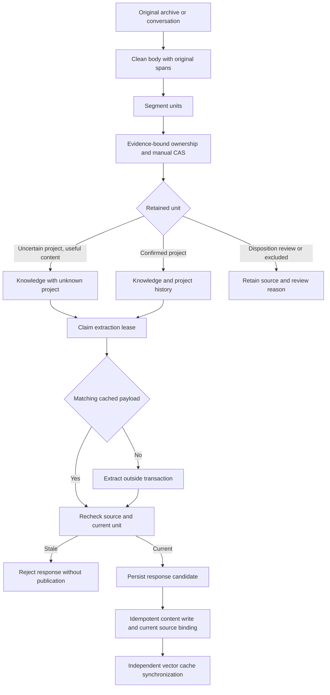

# Source-bound primary extraction

Primary organization first classifies each original-source unit through the existing quote, project registry, manual-decision and revision checks. It then extracts development knowledge and project history. Unresolved units remain in review. A source file's workspace or archive project never substitutes for a unit's confirmed ownership.

Development knowledge can remain useful while its project is unknown. Such a source is recorded with empty projects and unverified ownership, not global applicability. Explicit global scope remains separate. Disposition review or set_aside is excluded from extraction; history_only is excluded from reusable knowledge. Multiple confirmed project scopes remain represented. These are ownership decisions, not proof that a method succeeded.

## Retry and concurrent-edit behavior

The extraction receipt key contains pipeline version, original source identity and revision, organization rule revision, unit digest, exact text and offsets. A lease prevents simultaneous requests for the same extraction. The model runs outside a database write transaction. Source and unit versions, current task status and original text are checked before and after the call. A stale response is not cached or published.

The receipt saves a validated model response independently from publication. A saved response is a reusable candidate, not a successful write receipt. This deliberately differs from caching result IDs: a database failure can retry publishing without paying for another model request, while a human project correction can rebind the same content to the current source decision. Each replay rechecks source currency. Source bindings and knowledge upserts use one transaction and a local savepoint. Published IDs deduplicate by content. Project events deduplicate by project and content; project summary rebuild remains retryable after event persistence.

Receipt replay never confirms a candidate's outcome or changes a pending/archived capability to active. The source-binding evidence_status field describes ownership only. Existing structured-experience success verification continues to require an actual relevant tool result, user confirmation or verified historical evidence.

## Validation

New governance tests reproduced nine failures and one existing passing exclusion before implementation. The implemented behavior covers repeat requests, repairing a missing binding on replay, source edits during model calls, review/disposition gates, ownership-only changes, multi-project preservation, failed publication retry, malformed model actions and concurrent lease claims. Combined ownership, store and pipeline tests passed 131 cases on 2026-10-31. The typed-ownership repair was separately applied to a writable copy: 230 inserts, zero additional effects on repeat, all 230 safely rolled back, repeated rollback unchanged and SQLite quick_check ok.

Remaining stages are capability-source currentness/backfill, full-set vector reconciliation, richer project/module candidate recall and evidence-backed value assessment. This document does not claim historical migration or production deployment is complete.
