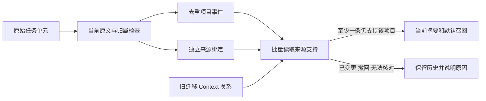

# 项目事件的来源与当前有效性

2026-10-31。隔离实现；不代表已迁移或部署生产历史。

项目事件继续按项目、事件类型、标题和正文去重。新增 `project_event_sources` 保存每个来源的独立绑定：event ID、source kind/key/ref/revision、Context ID 或 task ID/digest/unit revision、原归属范围和绑定哈希。event ID 与 capability memory ID、Context item ID 各自独立。

`ProjectArchiveStore.record_event(draft, source=ProjectEventSourceDraft(...))` 在同一事务及局部 savepoint 内保存事件与来源；即使上层捕获来源 SQL 错误，也不能提交一条无绑定的新事件。同一绑定重复提交无新增行；来源变化以新的绑定快照保留。该 source 类型复用通用来源字段结构，不复用能力记忆 ID。

自动提取绑定真实任务单元。手工事件必须由调用方显式提交 confirmed manual 来源；缺少来源不会被默认为人工确认。模型日期必须在缓存之前通过 `validate_occurred_at`，无效日期不会污染提取缓存。

## 当前读取规则

默认 `events(project)`、`get`、`rebuild`、MCP 项目历史和项目摘要，只使用至少一条当前来源支持的 active 事件：

- 复用 `capability_provenance.ProvenanceRead.evaluate` 的内容版本、原文可读性、来源撤回和当前归属检查；检查的是来源，不是能力记忆对象。
- 来源当前且当前项目包含事件项目，才能支持该事件。多项目 applicability 不能自动成为多个项目的变更历史；仍采用 `history_projects` 的唯一 owner 证据规则。
- 人工从甲项目改到乙项目后，甲项目事件退出当前摘要；重跑可复用已缓存的提取正文，给乙项目保存其事件。
- 同一事件有多个来源时，撤回一条不会抹掉其余有效来源；全部撤回后事件仍在原表，但退出当前摘要。
- 归档项目的别名不能绕过默认 active 项目查询限制。

当前有效性是每次读取时的投影，不通过删事件或修改原文实现。已有历史但当前有效事件为零时，rebuild 可以保存零有效事件摘要；完全没有事件的项目仍报 `empty_summary`。

## 旧数据兼容

旧迁移关系 `knowledge_restructure_map.target_kind='event'` 和明确的 `context_item:<id>` / `context:<id>` 可以定位 Context 来源，再检查当前内容资格与已确认项目。原文 `archive/conversation/item#digest@range` 只有唯一当前单元时才可解析；裸 archive 项目不能掩盖混合会话。

缺少 native 绑定时，可信旧来源可只读解析，不会因缺新表关系而一律隐藏。native 来源与独立旧 Context 来源合并时保留二者；同一来源已有明确绑定时，不用动态旧 fallback 绕过该绑定的版本检查。来源歧义、缺失或归属不明会给出 reason，不创建猜测归属。

旧映射无法补造历史时点的版本证据。返回 `legacy_source_fallback=true` 表明依据已有迁移关联进行了当前资格检查；这不等于已完成版本化迁移。

## 历史浏览

`events(project, include_historical=True)` 保留所有事件状态，并附：

- `current_support`：当前是否至少有一个有效支持来源；
- `source_diagnostics`：各来源 valid/current_support 与 reason；
- `sources_count` 和 `legacy_source_fallback`。

Web 历史分页保留这些事件和诊断，摘要仍只含当前支持事件。目录一次批量注释当前页各项目的事件，返回 `event_count`（当前有效）、`historical_event_count`、`unsupported_event_count`；详情另有 `current_events_total`。UI 展示文案由主集成流程接入。

## 验证与边界

合成临时数据库测试覆盖人工移动、撤回、多个有效来源、来源版本变化、独立旧 Context 与新来源混合、item 编辑版本、ID 空间碰撞、历史可见性、日期缓存失败及来源保存原子性。旧测试的人工事件改为显式 manual 来源；旧迁移 fixture 明确设置人工归属。

当前支持证明来源和项目仍有效，不声称模型提炼的事件内容已经得到独立的成功结果验证。项目事件的原话/结果级别结构化核验仍属于后续内容价值闸门。未执行生产写入或历史重跑。
