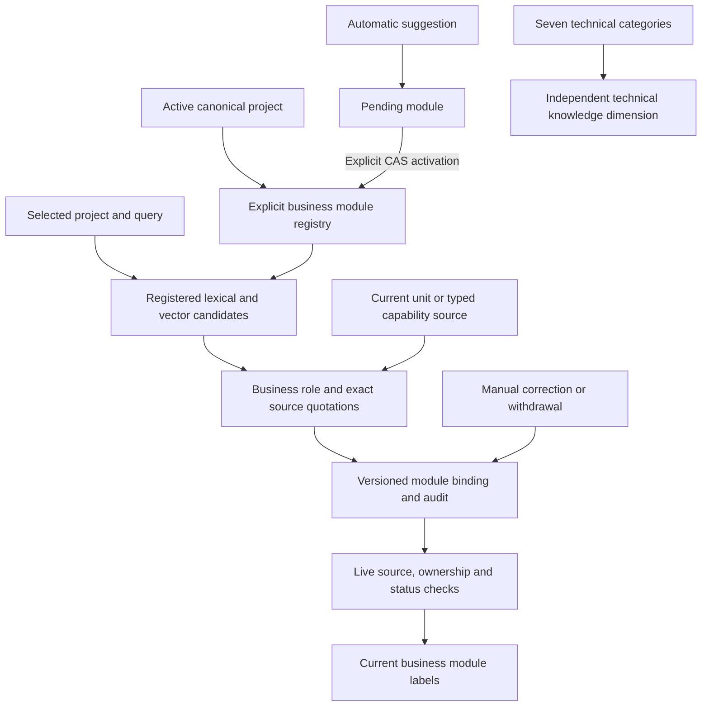

# Project business modules

A business module is a registered child of exactly one canonical project. Its stable `mod_…` ID is separate from the project ID, workspace binding, task hierarchy and seven capability categories. For example, an order workflow may be a business module; `frontend`, `backend` and `database` remain technical categories and never automatically create modules. There is only project → module depth. No module parent, project rename or inferred hierarchy is introduced.

The initial registry is empty. Unclear content remains unclassified. Automatic analysis can suggest a pending module but cannot activate it. A candidate search only searches registered active modules within the selected project; lexical and injected vector scores are ranking signals, not binding authorization.

## Integration contract

`evolvmem.project_modules.SCHEMA` is additive. The owner initializes it in its ordinary migration path; `ProjectModuleStore(context_store)` never creates tables or changes data. This implementation does not initialize production or backup databases, add routes, or seed business modules.

| Method | Contract |
| --- | --- |
| `create(project, name, aliases=(), description='', explicit=True)` | Explicit creation of an active module; project must be an active canonical registry key. |
| `suggest(project, name, aliases=(), description='')` | Creates pending only; an existing normalized name/alias returns its existing module without editing it. |
| `get(module_id)` | Reads the stable ID, canonical project, name, aliases, description, status and revision. |
| `list(project, include_inactive=False)` | Active modules by default; pending/inactive records remain available for management. |
| `update(module_id, expected_revision=…, explicit=True, name=…, aliases=…, description=…, status=…)` | CAS update; project and module ID cannot be reassigned. |
| `activate` / `deactivate` | Require `expected_revision` and `explicit=True`; activation is never a model side effect. |
| `candidates(project, query, vector_scores=None, limit=10)` | Read-only ranking of registered active modules. `vector_scores` is an ID→score mapping or a callable `(query, allowed_module_ids) → mapping`. Other-project IDs are ignored. |
| `bind_unit(module_id, task_id, digest, …)` | Binds a current organization unit, using the source contract below. |
| `bind_source(module_id, capability_source_id, …)` | Binds an existing typed unit/Context capability source, using the same contract. Arbitrary manual/reference URLs do not become source evidence. |
| `unbind(binding_id, expected_revision=…, explicit=True)` | Audited manual withdrawal; retains the row and prevents automatic resurrection. |
| `binding_status(binding_id)` | Returns stored metadata plus live `valid`, `reason`, `not_recalled`. |
| `modules_for_unit(task_id, digest)` | Merges currently valid direct unit bindings. |
| `modules_for_memory(memory_id, allowed_source_ids=None)` | Merges currently valid module bindings across supported sources; duplicate module IDs retain all supporting binding IDs/source keys. |

`explicit=True` is an intentional caller action marker, not authentication. The API/UI boundary must derive it from an authorized user operation; do not pass model-produced values through as manual authority. Module mutation and binding audit run in the same transaction/savepoint. An audit failure or name conflict cannot leave half-created names or bindings, even when the caller catches the exception in an outer transaction.

Names and aliases share a project-local namespace, normalized with Unicode NFKC, case folding and whitespace normalization. The same label is allowed in another project. Inactive/pending modules reserve their current names to prevent ambiguous re-creation. Editing requires the latest revision and preserves the module ID. `project_module_audit` records before/after values, action, actor and timestamp for creation, suggestion, update, activation, deactivation, binding and withdrawal.

## Binding evidence and freshness

Both binding methods accept these keyword arguments:

```python
quote='Unique exact original quotation',
role='owner',                 # owner / applicable / related / uncertain
decision='auto',              # auto / manual / review
chain={'change': 'Unique exact original quotation'},
expected_revision=0,         # 0 means no binding exists yet
explicit=False,              # must be True for manual decisions
```

The source must pass `ProvenanceRead` and its currently confirmed projects must include the module's project. A source's old `source_project` or binding `projects` claim is never sufficient. Original text must contain the quote exactly once; select a longer quote when a phrase repeats. An automatic active binding additionally needs an `owner` or `applicable` role and at least one exact `need`, `analysis`, `change` or `result` quotation from that same original text. Candidate scores cannot substitute for this structured evidence. This validates provenance and structure; business reasoning still belongs to the caller and remains reviewable. A `review` decision is saved but does not supply a current module.

Bindings preserve source key/ref, content source revision, unit revision and source-binding revision where applicable, content/source fingerprint, quote, role, evidence chain, decision and revision. The source-binding revision is audit metadata; an ownership-only revision does not invalidate otherwise unchanged content. The fingerprint covers source identity, original ref/range, content revision and digest. Current project membership is checked separately. A direct unit's `origin_anchor` is `unit:<task_id>:<digest>`; a Context source uses `context:<item_id>`. Capability-source IDs resolve to that same anchor for manual protection. Therefore, an automatic decision cannot bypass a manual correction or withdrawal by switching from a unit key to an equivalent capability-source ID. Existing automatic rows on that same module/anchor also stop supplying a module once a manual decision exists.

Every current read rechecks module/project status, live source provenance, current project membership, source fingerprint and quotation. Module deactivation, project archival, withdrawn/superseded source, changed original text/range or source version immediately removes the binding from current module results. Rows and audits remain as history. Ownership-only unit revisions may retain valid content when the original digest is unchanged, but moving the unit to a different project invalidates this module binding.

For a capability-source binding, archived/ignored capability objects cannot supply current module evidence. Active and pending objects may be classified for management. Pending capability classification returns `not_recalled=True` and never changes the capability's pending status. Modules are an ownership dimension, not a successful-experience or value verification mechanism.

`modules_for_memory` deliberately distinguishes its optional source filter:

- `None`: ordinary management browsing, using all currently supported source relations.
- An empty set: no permitted sources, so no modules.
- A set of source IDs: only those source relations can supply module bindings.
- `{None}`: only legacy fallback relations that do not yet have persisted source IDs.

For recall, pass the source IDs already admitted by the combined provenance/value gate. This prevents a new low-value source from supplying a module label through another source's valid value assessment. Root recall still decides whether the capability itself is active/eligible. The module API does not promote pending content or duplicate that policy.



## Verification

Real SQLite tests started with the missing module and then passed after implementation. They cover cross-project rejection, pending-only suggestions, empty registry behavior, no technical-term seeding, name/alias collisions, stable IDs, revision CAS, read-only candidates, structured quote validation, same-origin manual protection, source and project invalidation, inactive modules, Context source bindings, pending management classification, allowed-source filtering, and atomic audit failures. Only disposable test databases were written.

```bash
/home/jiangli/hermes-memory-plugin/.venv/bin/python -m pytest \
  tests/test_project_modules.py tests/test_capability_provenance.py \
  tests/test_capability_provenance_repair.py tests/test_project_store.py -q
```


## Bounded module response correction

The automatic pipeline accepts a module inclusion only when its quote and every supplied chain field are exact original substrings and the existing role/provenance checks pass. It never drops a bad chain field to accept the rest. Known JSON, module-shape and evidence errors receive at most one correction call with the same source and registry. Source/unit state, registry revision and the extraction receipt's token and expiry are rechecked before and after each call. Transport, permission, runtime, source-CAS and lease errors still stop processing.

After two invalid responses, the server caches a `technical_review` containing `reason=model_response_invalid`, two safe validation codes and `attempts=2`. Every affected module receives a review item; rejected quotes and chain text are discarded. This technical result creates no binding and does not retract an existing valid binding. Live source/module validity checks continue to control whether an old binding is current. It is distinct from an ordinary semantic exclude/review judgment, and the model cannot supply the server-only technical metadata itself.

`process_task` returns `technical_review` as a count of affected units. Both primary and dual organization modes add this count to the task's review count and finish it as `review/done` with `error_code=module_response_invalid`. Manual ownership stays unchanged. The same frozen input reuses its technical-review receipt instead of repeatedly calling the model. Cached publication still executes the transactional `before_publish` guard.

No schema changes are required. The optional `guarded_extract` callback in `extraction_payload` exposes its current source/lease check only to bounded extractors; existing callers retain their original behavior.
