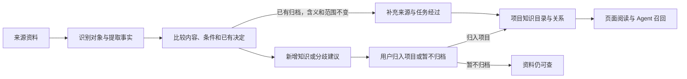

# EvolvMem 知识自动整理功能说明（SPEC）

日期：2026-10-18 · 版本：v1.1 · 状态：第一批代码与模拟验收完成；第二至四批待实施

本功能把多次工作留下的零散记忆组织成可阅读、可追溯、可更新的项目知识，减少重复分类和人工整理。跨 Agent 工作交接已由用户确认可用，本次重点是知识组织。

## 1. 已确认的需求与边界

- 同一件事被多个 Agent、多个会话反复提到，应汇总到一起，保留各自来源。
- 已确认的项目归属应持续有效；改写摘要、切分或合并资料、重跑整理不能要求用户重复分类。
- AI 永远只建议项目归属。用户使用“归入项目”或“暂不归档”，选好项目即可直接保存。
- 项目知识应能回答：现在怎么做、为什么这样做、从哪些任务形成、哪些经验经过验证。
- 本文的业务约束来自用户确认；用户已确认继续第一批实现，后续数据模型与页面按第 11 节分批落地。

## 2. 首期交付范围

完成“接收资料 → 识别同一对象 → 汇总知识与来源 → 用户处理必要变化 → 按项目阅读和召回”的闭环。
首期以 EvolvMem 自身的项目归类迭代为试点；使用模拟资料及获准使用的资料范围，包含其他项目名称作为干扰条件。
提供项目知识目录、知识详情、来源与变化记录，以及“相关知识”关系列表；首期不要求绘制全局交互式知识图。
不改造已可用的跨 Agent 续接，不重写全部历史资料，不新建消息队列或分布式服务。
“自动整理”包括聚合、关联和组织展示；“正式归档”指用户保存项目归属，两者分别记录。

## 3. 用户怎样使用

1. 打开项目，先看到“业务规则、运行与部署、问题处理、决策变化、开发经验”目录；空目录不展示。
2. 打开一条知识，看到当前内容、适用条件、是否存在争议、关联任务及来源；旧版本可展开查看。
3. 新增资料先自动整理：重复表达增加来源，同一任务的进展并入经过；不会把每段话都做成待审核卡片。
4. 需要决定时，按知识对象集中呈现新增内容、具体分歧及 AI 建议；原有已确认内容保持可用。
5. 用户选“归入项目”并选择一个或多个项目后直接保存，或选“暂不归档”；不要求先“保留”、先运行 AI 或先预览。
6. 同一问题处理一次后，后续相同来源、相同分歧不再弹回；用户仍可主动修改归属、拆开错误合并。

例如：“修复集成平台的执行器，并用报表项目验证”。实际修改对象是执行器，报表项目是验证场景；仅凭提到报表项目，不能建议把整项工作归给它。归入集成平台由用户保存，报表项目可通过“用于验证”关系找到相关资料。

## 4. 数据怎样组织

采用以下逻辑模型；优先复用现有来源、知识、证据和版本记录，不要求每行都新建一套表。

| 对象 | 记录内容 | 解决的问题 |
| --- | --- | --- |
| 来源证据 | 来源 ID、会话/事件、原文定位、来源版本、内容摘要校验值 | 追到原话；同一次导入重试不重复累计 |
| 知识对象 | 稳定 ID、名称/别名、类型：项目、任务、组件、知识主题 | 改标题或换一批资料后仍识别同一对象 |
| 事实版本 | 稳定事实 ID、版本、主体/属性/值、条件、业务有效时间、系统记录时间、来源、验证状态 | 区分重复、补充、变化和矛盾；不以入库先后冒充事实先后 |
| 类型化关系 | 起点、关系类型、终点、依据的事实版本、条件、来源、建议或已确认状态 | 区分归属、提及、使用、验证、适用和替代 |
| 人工决定 | 决定 ID、对象及所覆盖事实/条件、归入项目或暂不归档、项目集合、保存人、版本 | 把决定绑定到明确内容，避免被文本切分或模型输出覆盖 |
| 项目阅读视图 | 目录、知识条目、相关知识、变化摘要；引用上述记录 | 自动生成可读结果；可重建，不成为另一份权威资料 |

知识对象是“讨论的东西”，事实是“关于它的具体说法”。例如“执行器”是对象，“当前运行于 Windows”是带条件和时间的事实；同一对象可以有多条不同事实，不能全部合成一句话。
事实被用户归档不等于事实经过验证；原话、AI 推断、工具验证、用户确认等证据等级必须分别保留。

关系首期限定为：属于项目、涉及、使用、修改、适用于、支持、验证、补充、替代、存在分歧。
“属于项目”由人工决定生成；AI 的归属建议另存。“提及”“使用”“用于验证”及主题聚类不产生正式归属，也不沿关系自动传播归属。
项目可有多个，关系可跨项目；跨项目引用保留原知识身份与归属，不复制知识，也不扩大适用范围。

## 5. 自动处理与人工处理规则

| 输入变化 | 自动处理 | 是否需要用户处理 |
| --- | --- | --- |
| 同一来源重复导入或任务重试 | 复用来源、事实与决定 | 不需要；所有数量保持不变 |
| 已确认同一事实增加来源或换一种说法 | 保留事实 ID，聚合来源和不同表述 | 不因增加来源重复确认归属 |
| 同一任务增加进度或结果 | 关联到原任务的过程；原归属不变 | 不重审旧内容；新增独立知识另给建议 |
| 新知识尚无归属 | 聚合后给出一次项目建议 | 用户可归入项目或暂不归档 |
| 新内容超出原决定覆盖的知识或适用条件 | 保留原决定，只提出新增部分的建议 | 只处理新增部分 |
| 同一对象在不同环境、版本下有不同做法 | 分别存放条件，建立关联 | 不仅因文字不同就制造冲突 |
| 相同条件下出现互斥说法或冲突的人工归属 | 保留双方及来源，合成一项分歧 | 用户决定如何处理；AI 不自动覆盖旧决定 |
| 有明确生效时间的变化 | 保存新旧版本及替代建议 | 涉及已确认结论的替换须用户确认；迟到资料不自动覆盖 |
| 用户选择暂不归档 | 保存此决定，资料可查 | 同样内容不再次催审；实质新增部分可另给建议 |

**怎样确认“同一条”：**优先复用明确的任务/对象引用、既有映射及已确认别名；同一对象下内容和条件完全一致可确定性去重。文本相似或模型判断只能生成可撤回的聚合建议，不能单凭相似度吞并两个已确认对象、继承项目归属或宣布旧事实失效。
尚未确认的语义聚合可在“待归档”中按组展示，减少逐段操作；它不增加已归档数量，也不混入默认的已归档知识召回。用户保存该组明确列出的内容后，才建立对应的人工决定。
已经确认的同义表达以后沿用该映射；新出现且含义不明的表述保留为候选关联，不重复要求确认原知识。

**人工决定的覆盖范围：**保存时明确绑定当前选中知识及其条件；同一知识追加证据不扩大范围。新要求、新知识、新适用条件不得因被放进同一任务而自动获批。
合并时若两边的人工决定一致且覆盖范围匹配，可共同展示并保留决定记录；存在冲突则分开呈现。拆开时只迁移能定位到对应事实的决定，不能把一个结论复制给全部子项。
分歧以“对象、冲突事实、条件、决定版本”标识；同一分歧只出现一次。新增实质证据可补充原分歧，换来源批次或重写摘要不能重开已解决分歧。
处理分歧时可选择采用哪条结论，或分别补充适用条件后保存；仅改归属不算解决内容矛盾，暂不归档则保留分歧并停止催审。
模型发现可能矛盾时，当前阅读视图标明分歧，旧决定仍可追溯；模型没有直接废止人工决定的权限。

## 6. 处理流程与职责

来源层保留原文和定位；组织层负责识别对象、比较事实、生成关系；决定层只执行明确的人工保存；阅读与召回层使用同一份已归档状态。
新知识建议可单独查看与检索，默认项目召回必须区分已归档知识和待确认内容；存在分歧时同时返回冲突提示及对应来源。
开发经验只引用实际验证记录。重复转述同一次成功不会增加验证次数，AI 总结“已完成”不自动成为成功证据。

## 7. 首期技术路线与 Graphiti 的使用边界

首期保留现有 SQLite/Context Core 作为来源、人工决定及已归档状态的权威存储，增加稳定对象与关系表达；知识目录和关系列表由这些数据生成。
借鉴 Graphiti 的实体识别、多来源支持事实、类型化关系和时间版本处理；这些是组织机制，图的展示只是读取结果的一种方式。
不直接套用模型对旧事实的自动失效逻辑到人工决定，也不把自动生成的主题社区当成项目边界。
在采用完整 Graphiti 引擎前，用本说明的同一组模拟验收集比较：归并正确性、分歧发现、人工操作数、调用耗时与模型用量、依赖与运维成本。没有实际结果前不承诺收益比例。
若复用 Graphiti 需要新增依赖或服务，先交付上述比较结果和接入边界，再确认实施；它不能成为本次整理闭环的前置迁移要求。

页面保存应同时更新决定与归属；失败时不出现半条已归档记录。重试复用操作标识，不能重复入库。
AI 超时或不可用时，既有知识和手动归档仍可操作；提示本次未完成的整理范围，重试从未完成处继续。
前端缓存已打开内容、查询及草稿；切页返回直接恢复，不为单纯浏览反复核对。保存与明确刷新才按需要处理更新，迟到响应不能覆盖当前选中的资料。
页面文案采用业务语言与正常字号；保存按钮旁只展示阻止保存的真实原因，不堆小字说明。

## 8. 验收标准

以下为首期整体验收要求；第一批实际验证范围见第 11 节，不表示 A1–A12 已全部通过。

| 编号 | 场景 | 必须得到的结果 |
| --- | --- | --- |
| A1 | 同一已归档事实被两位 Agent 重复提交，含已确认的同义表达 | 展示为一条知识，多份来源；归属确认次数为 0 |
| A2 | 同一批资料重试三次、改摘要、重新切分再合并 | 已保存决定不丢失；已归档数、来源数无重复增长，不新增待审 |
| A3 | 修复平台能力，但使用另一个项目验证 | 修改对象、验证场景关系分开；不把提及项目变为归属 |
| A4 | 已归档任务追加普通进度，随后提出适用范围更大的新要求 | 旧知识无需重审；新要求单独给建议，未保存前不扩大归属 |
| A5 | 同一主题包含 Linux 与 Windows 两种部署条件 | 两条有条件的事实并存，查询各自环境得到正确内容 |
| A6 | 相同条件下两条互斥结论被多份来源重复提及 | 一项分歧含双方来源；处理后重跑不重复催审 |
| A7 | 已确认的新版本之后才导入旧版本记录 | 当前结论不倒退；可按业务时间查看旧事实及其来源 |
| A8 | AI 建议为 0 条或模型失败，但用户已选择知识和项目 | 可直接保存；结果显示实际保存的知识数量及项目 |
| A9 | 资料暂不归档后又被重复导入；已确认对象被错误建议合并 | 不重新催审、不改原归属；可拆开聚合且来源与决定不丢失 |
| A10 | 多条知识组成项目目录，页面与 Agent 分别检索 | 能回答现状、来由、变化和适用条件；每条结论均可定位原文 |
| A11 | 连续切换左侧资料、切页返回、保存失败后重试 | 右侧内容对应当前选择，草稿保留，操作无重复写入 |
| A12 | 两次有原始证据的独立验证，其中一次被重复转述三次 | 仅计两次独立验证；转述保留来源关联，不增加次数；归档不提升验证等级 |

在相同样本上对比现行流程与新流程，记录：待处理知识组数、用户实际操作次数、重复确认数、错误归并数、错误归属数、来源缺失数及处理耗时。
验收集的重复确认、错误归并、未经用户保存的新增归属、来源丢失均须为 0；包含重复资料的样本中，用户操作数须少于现行流程。未满足则不能以“图已生成”判定完成。
AI 质量只按这份样本报告，不推断任意历史资料都已正确；多 Agent 交接仅做受影响接口的兼容性检查。

## 9. 历史资料与交付

先从模拟样本跑通，再对已获准的有限历史范围生成只读整理预览，列出将聚合的知识、现有人工决定和分歧；预览不改正式归属。
正式接入须保留旧记录 ID 与映射，不能用整库重分类初始化。原来源及人工决定不删除；新阅读视图可关闭并恢复原展示。
实际开发交付需包含：通过上述场景的可操作页面与召回结果、前后操作数对比、对应工作原理图更新；不额外建立多套文档。

## 10. 依据

用户在本会话确认：跨 Agent 交接已达标、人工整理过重、AI 仅建议项目归属、选项目直接保存。
当前代码基线：83b0dad；重点参考 conversation_tasks.py 的原决定保护、organization_context.py 的增量上下文、context_store.py 的来源/证据/版本模型。现有机制是复用基础，不能据此宣称本说明已实现。
Graphiti 官方参考：[数据模型](https://github.com/getzep/graphiti/blob/main/graphiti_core/edges.py)、[实体与关系类型](https://help.getzep.com/graphiti/core-concepts/custom-entity-and-edge-types/)、[主题社区](https://help.getzep.com/graphiti/core-concepts/communities)。

## 11. 实施顺序

- [x] **第一批：稳定知识身份与人工决定。** knowledge_identity.py 保存稳定 ID、原文范围、人工决定与变更版本；重组和直接保存接入原事务。208 项相关测试及直接归档、切换资料、产品模块三套浏览器验收通过。已验证同源拆合与重试、明确项目下原文完全一致的多来源复用、旧记录按需接入、暂不归档及恢复、部分改归属、失败回滚；新要求不能沿用旧决定。覆盖 A1 的确定性重复、A2、A4 的范围保护、A8 和 A9 的暂不归档部分；新同义关系、分歧处理及新增内容单独展示仍属后续批次。未重跑正式历史，原记录 ID 与来源保留。
- [ ] **第二批：事实版本与关系。** 在组织流程加入带条件的事实、多来源证据及类型化关系；沿用 ownership_reasoning.py 区分修改对象与验证场景。实现分歧聚合、人工解决与错误聚合拆开；同一证据事件只计一次验证。交付可查询的关系和版本结果，验收 A3/A5/A6/A7/A12 及 A9 的拆开场景，AI 建议不能改写人工决定。
- [ ] **第三批：项目阅读与召回。** 在 knowledge.js、review-groups.js 展示目录、来源、关联和变化，context_retriever.py 按相同归档状态返回内容；缓存当前选择与草稿，保存结果按实际知识数显示。验收 A10/A11，并回归 A8；用 review_direct_archive.e2e.cjs、review_selection.e2e.cjs 核对直接保存和切换行为，不把生成目录等同于知识已确认。
- [ ] **第四批：整体验收与接入。** 在独立测试库运行 A1–A12，按第 8 节比较操作次数与错误数；已有通过项只在变更影响时重测。获准范围的历史资料先生成只读预览，验证旧 ID、来源、人工决定和原展示可恢复；同步 principles.js 并检查 product_modules.e2e.cjs。实际功能交付按项目规则提交、导出发布及回读总控台登记；本次文档补充不执行部署或历史重跑。
