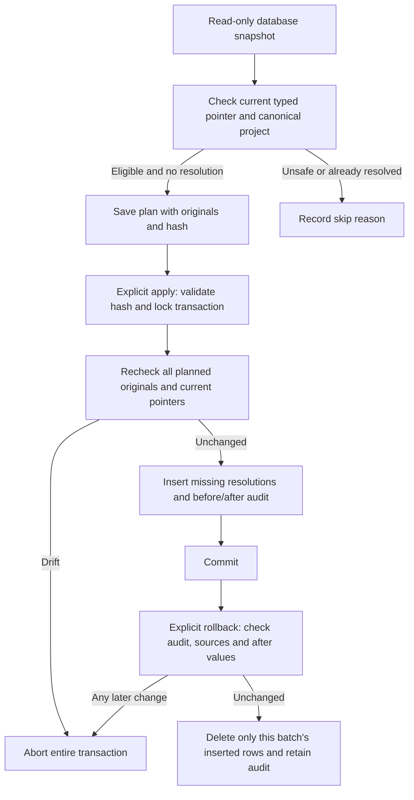

# Historical typed ownership repair

`python -m evolvmem.typed_ownership_repair` repairs missing ownership provenance for current continuity checkpoints and project rollups. It uses the existing typed pointer and canonical registry entry; no text classification, model request, archived task replay, or archive rewriting occurs.

## Eligibility and boundaries

A row is eligible only when all of these conditions hold:

- The context item is an active `workstream_checkpoint` or `project_summary`, has project scope, a nonempty project, and no `superseded_by` pointer.
- No ownership resolution exists. Any existing resolution, including automatic, human, rejected, unresolved, or global, is preserved.
- Exactly one current pointer across `continuity_workstreams` and `context_project_rollups` refers to the item, and its table matches the context type.
- The pointer project and context project exactly equal an active canonical registry key. Aliases, body text, workspace similarities, and historical pointers are not substitutes.
- A rollup is `ready` or `vector_dirty`. Current checkpoints of completed workstreams remain valid project history; a completed workstream is not a superseded context item.

The only business table written is `context_project_resolutions`, using the existing `ProjectResolutionDecision.resolved` contract: `automatic`, `resolved`, `not_required`, method `explicit_project`, medium confidence, revision 1, and typed evidence with the existing four evidence fields. This records ownership provenance, not verification of an experience or its outcome. Context scope, project, content, timestamps, sources, registry, raw archives, and old tasks are unchanged. In particular, `global` is never converted to project scope. Experience rows are counted and left untouched.

## Review and execution

All commands require an explicit existing database. Preparation connects with SQLite `mode=ro` and `query_only=ON`, reads one transaction, and never initializes `ContextStore`. A missing database fails instead of creating one. Prepare and inspect a plan on a self-contained backup before considering a write. Keep the plan local: it contains item IDs, canonical project names, pointer metadata and workspace fingerprints, but no memory layers or raw archive bodies.

```bash
python -m evolvmem.typed_ownership_repair \
  --database /absolute/path/rehearsal.db \
  --output /absolute/path/typed-plan.json

python -m evolvmem.typed_ownership_repair \
  --database /absolute/path/rehearsal.db \
  --apply-plan /absolute/path/typed-plan.json

python -m evolvmem.typed_ownership_repair \
  --database /absolute/path/rehearsal.db \
  --rollback-plan /absolute/path/typed-plan.json
```

Output files must not already exist. With no action flag, the CLI prints a dry-run plan only. Apply and rollback connect with `mode=rw` to the supplied file only, not to a configured owner database. The plan intentionally has no database pathname binding so that an exact self-contained copy can rehearse the same plan. It does bind every proposed row to its original source and ownership metadata.

The plan hash covers the full canonical JSON except `plan_sha256`. Apply validates format, hash, unique IDs, and every change against a newly computed eligibility snapshot under `BEGIN IMMEDIATE`. The snapshot includes expected missing resolution revision 0, context identity/type/project/scope/status/supersession/timestamps, the full current typed pointer (including checkpoint/state or rollup revisions), and registry revision/metadata. Rehashing an edited plan cannot bypass these checks. Unrelated new items do not change the reviewed batch. A changed planned source, a new human decision, an SQL failure, or an unexpected persisted resolution rolls back the whole batch.

`typed_ownership_repairs` is created only during a nonempty successful apply. The same transaction saves the exact plan, application time, absent before rows and full persisted after rows. Repeating that applied plan returns `already_applied: true` and performs no repair writes, even if later users have changed a row. That receipt confirms the earlier application, not the current validity of every row.

Rollback requires the saved plan, audit, exact current after values, and unchanged source snapshots for every affected item. Only then does it delete this repair's inserted resolutions in a single transaction and mark the audit as rolled back. Later human decisions, source pointer changes, or registry changes cause `rollback_conflict` with no partial deletion. The audit remains available. Repeated rollback returns `already_rolled_back: true`; a rolled-back plan cannot be applied again (`repair_previously_rolled_back`), preventing a retry from silently undoing an intentional rollback. Use a fresh disposable copy for another rehearsal of that same plan. Backups remain necessary; this command is not a replacement for database backup/recovery.



## Validation evidence, 2026-10-31

The initial 25 SQLite tests failed because the module did not exist, then all 25 passed after implementation. Tests cover read-only preparation, current checkpoint and rollup provenance, missing/inactive projects, inactive/superseded items, global scope, manual and automatic resolutions, ambiguous pointers, source version changes, invalid or rehashed plans, insertion failure rollback, repeated apply, and rollback refusal after later edits. Additional boundary tests cover empty projects, wrong typed tables, aliases, and failure on the second rollback deletion. Related project history, store and progress recall tests are included in regression validation.

Read-only planning against the dated baseline backup found exactly 230 eligible items: 216 workstream checkpoints and 14 project summaries. Of 3,105 scanned typed items, 1,900 already had resolutions and 975 were inactive. Nine active experiences lack resolutions and remain outside this repair. The plan SHA-256 is `e216c0e8433ad2f2faae5b5ec43da0d7dde285ef4e626dbdde0580bcaa627881`. Database SHA-256 before and after preparation matched. This is planning evidence only; no baseline or production apply was performed for these results.

```bash
/home/jiangli/hermes-memory-plugin/.venv/bin/python -m pytest \
  tests/test_typed_ownership_repair.py tests/test_project_history_repair.py \
  tests/test_project_store.py tests/test_project_progress_recall.py \
  tests/test_project_recall_progress_integration.py -q
```
