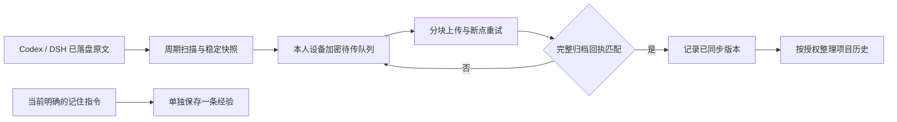

# Windows 桌面自动归档

## 四条独立链路

- **MCP 连接**：Codex / DSH 可随时调用已授权的记忆工具。联网成功不证明聊天已同步。
- **原文归档**：本机保存的完整原生会话，经加密待传队列补传到本人命名空间。以服务器确认的来源摘要、完整长度和归档 ID 为准。
- **项目历史与摘要**：依据原文按授权整理；全局 AI 整理暂停时，不因原文上传而自行开启。
- **经验与任务进度**：明确要求记住的经验、里程碑检查点，由工具调用分别写入，不依赖关闭会话。

## 保存流程



## 运行与验证边界

不要求关闭会话。电脑关机或用户退出时无法上传，下次登录再继续；未落盘内容不在归档承诺范围内。

客户端要保留完整原始内容，不能把工具调用、系统事件或分支来源偷偷删除后声称完整归档。旧格式不受支持时保留源文件并单独报告，不伪装成新格式。项目归属依据明确映射，混合工作区与未知项目保持未归属。

待传版本的次序在重试中固定；新版本归档后，迟到旧版本不得覆盖当前版本。上传失败不清除待传数据，不能以发出请求或收到部分块作为成功证据。

验收分别覆盖真实来源的内容摘要与长度、计划任务自动运行、无修改重跑、失败重试及中断恢复。模拟验证不能替代实际桌面来源的服务器回执；当前会话继续增长时，报告已核对版本的时间与覆盖范围。


## DSH 安装与运行

每 60 秒扫描 DSH 已落盘的原生日志；登录 Windows 后也检查。会话窗口不用关闭。
只上传原文到本人的 EvolvMem 空间，`extract=false`，不调用模型、不自动提炼经验、不启动项目摘要处理。

## 数据与边界

- 来源：`%USERPROFILE%\.dsh\sessions\**\session.v4.jsonl.zstd`（兼容未压缩 `session.v4.jsonl`）。
- 身份：复用 `%LOCALAPPDATA%\EvolvMem\Codex\config.json` 的 endpoint、expected_user、device_id，以及命名的 CurrentUser 环境变量令牌；不复制令牌、不猜项目。`project` 留空由服务端已有映射决定。
- 完整性：原始 zstd 完整解压，不转换 JSONL、不丢工具/系统事件，校验 v4 header 与连续 seq；大小与修改时间在读取期间变化则下轮重试。
- 队列：默认位于实际 Codex 数据目录的同级 `DSH` 目录，也可由安装参数 `-DataRoot` 指定，压缩后 DPAPI CurrentUser 加密；每会话最多两份未确认快照，2 GiB 总队列上限。未确认数据不删除；达到上限时源文件仍保留，下轮继续，状态明确显示 deferred。
- 续传：每个快照和偏移稳定标识，偏移原子写入；每个会话先完成前一版本。收到 archive_id、sha256、total_bytes、source_order、source_format 完全匹配的 archived 回执后才移除队列；当前版本额外验证 current=true。
- 后台：每轮最多 256 块、上传预算 45 秒，每会话最多 32 块；失败 30 秒起指数退避，最长 1 小时。所有错误只写固定代码，不记录凭证或聊天原文。
- 支持完整 native v4 主会话与子会话。旧 v0 若有相同身份、用户/助手/工具内容顺序一致且已归档的原生 v4，标记为已有归档新版的旧文件，保留原文件；这不是 v0 原始字节已归档的声明。其余旧格式单列 unsupported；seeded/fork 的继承协议未支持时明确拒绝，绝不删字段冒充新会话。
- 此扫描器确认**已落盘快照**，不能证明仍在 DSH 内存里、未持久化的事件已保存。原生 DSH 的 `session/event` 事件会持续写盘，`session/flush` 和会话释放另有持久化屏障；扫描器不强制关闭或重启 DSH。
- 扫描变化检测为文件 size+mtime；不防外部工具故意修改内容并保留两者。源与队列损坏会显示异常，不能声称已同步。

## 安装、检查、停用

以当前普通 Windows 用户运行 `install-dsh-archive.ps1`。安装前备份同名任务及已有程序；任务仅在该用户登录期间运行，使用隐藏 pythonw，无需管理员或存储账号密码。队列目录 ACL 限本人、SYSTEM、Administrators。

```powershell
& .\install-dsh-archive.ps1
Get-ScheduledTask -TaskName 'EvolvMem DSH Sync'
$configPath = Join-Path $env:LOCALAPPDATA 'EvolvMem\Codex\config.json'
$cfg = Get-Content -LiteralPath $configPath -Raw | ConvertFrom-Json
$dshData = (& $cfg.decoder_python -c 'from pathlib import Path; import sys; print(Path(sys.argv[1]).parent.resolve().parent / "DSH")' $configPath).Trim()
Get-Content -LiteralPath (Join-Path $dshData 'worker-status.json')
& $cfg.decoder_python (Join-Path $dshData 'program\dsh_archive.py') status
& .\install-dsh-archive.ps1 -Uninstall
```

上面的状态检查按默认数据目录解析；安装时指定过 -DataRoot 则使用该目录。

停用只取消本任务；原生日志、加密队列、回执、程序与备份全部保留。不会操作 Codex 的同步任务。

## 验证

在仓库根目录使用安装的 decoder-runtime Python（含 zstandard）运行 `python -m unittest discover -s tests/windows -p test_dsh_archive.py -v`。自动测试覆盖 UTF-8/U+0085、完整字节、失联续传、回执不符、重复扫描、未确认队列上限、截断压缩流、unsupported、收据提交中断、当前声明变化和版本顺序。

## Codex 大会话与积压补传

短时 Hook 只持久登记来源，不在 3 秒回调内重新加密整个长会话。后台扫描已登记且 size/mtime 未改变的文件时复用已验证状态；变更或新来源继续校验真实 header。采集与上传各有预算，避免采集占满整轮，上传跨会话轮换。

同一会话已有正在上传的快照时，先完成该版本，再采集原日志的新增内容。每块确认的偏移持久保存，进程重启继续补传；不会因为聊天持续增长让所有旧快照一直无法成为已归档版本。

`archive_extract_enabled=false` 只控制原文上传时不请求整理；不改变服务器的全局产品策略。`upload_chunks_per_session` 默认为 16，可在已核对带宽和内存后调整；块大小仍为服务端规定的 256 KiB。最终大文件确认需要足够 RPC 时间，仍以完整 SHA、长度、版本和 archive ID 为成功依据。

发出最终块前持久记录确认意图。若网络超时或进程中断导致最后回执丢失，下轮先向服务端查询同一 SHA、长度、格式、来源次序、当前版本和原文可用状态；精确匹配才记为成功。在最多 600 秒的最终处理等待期内避免重复提交昂贵的最终解析；明确拒绝和其他确定失败按正常规则重试。

已验证完整原文字节没有新增、仅文件时间或压缩外壳发生变化时，更新物理文件扫描状态，避免每分钟重复解压。所有后台入口统一使用安装路径，避免同一数据目录的不同路径别名产生不同互斥锁。

### 可恢复的旧快照收敛

从仓库的 scripts/windows 目录手动运行 prefix-coverage.ps1（维护工具，不由普通安装器自动执行）。它只处理已有完整归档回执的版本。它重新读取该归档版本对应的源字节并验证完整 SHA，再解密旧快照逐字节检查；仅相同会话的相同内容或严格前缀可以移到 `covered-prefix`。分叉、改写、更新的来源顺序和无法核对的文件保持待传。

移动前先持久保存 prepared 凭证，保留旧 SHA、来源次序、覆盖版本与归档回执；文件与凭证留在同一数据盘，可恢复，不删除原始日志。中断恢复仍核对清单版本，不能把后来重新捕获的相同内容误当成旧版本覆盖。

不要同时运行多个全量解密任务。大积压按少量版本分批处理，并观察可用内存与磁盘。`covered-prefix` 是可恢复副本，不表示已经释放这些副本的磁盘空间。
